# Model reference

The data dictionary of `ai-it-labour-sim`: every named item of the model, generated by `tools/model_docs.py` from the
engine and from the curated text in `src/aisim/data/model_docs.csv` and `model_modules.csv`. Do not edit this file;
edit the curated CSVs and run `uv run python tools/model_docs.py --write`.

- **What the model is.** A System Dynamics model of AI's impact on IT employment, contract mix and vendor viability,
  for India and onshore, 2024-2040. It gives scenario projections, not forecasts: read every value as "under these
  assumptions" (README).
- **Which model.** The default model is `phase9`, frozen at release 0.2.0. The parameter tables give the values of
  `phase9` and `phase9_highadoption` and flag where `phase7`, `phase8` or `phase8_highadoption` differ; every model's
  values are in `docs/model/inventory.csv`, and the dependency edges in `docs/model/edges.csv`.
- **Names are the engine's.** Every item is named as the code names it (`fl.openings` is the `openings` field of the
  S8c flows, `VF.Revenue` a field of a vendor's S10 terms); the specification's name, where it has one, is in the
  `spec_name` column of `inventory.csv`. Some names are shared by items of different kinds; the last section lists
  them, and each entry is qualified by its kind. An unnamed goal-seeking update term is `flow:<Stock>`.
- **Modules.** Each item belongs to exactly one of the 8 engine modules, the one where the quantity lives; the
  modules that also read it are in `inventory.csv` (`readers`).
- **Units.** "model-unit persons" are headcount in the model's own units: the calibrated stocks, not people.
  "persons" are real people, only in the outputs scaled to India's 2024 headcount. BFY is a unit of IT work (one
  person-year of 2024 delivery). Rates are "per year"; "years" is a duration, "year" a calendar year; "index (2024 =
  1)" is 1 in 2024 by construction. `unclear` means the sources do not settle the unit.
- **Status.** Every description and unit was drafted from the cited sources (`drafted`); a row is `reviewed` once the
  operator has checked it.
- **The specification's errors.** Where the original specification is wrong or inconsistent, and what the model does
  instead, is in [the spec errata](spec-errata.md).

## Modules

| Module | Display name | Colour | Description | Status |
| --- | --- | --- | --- | --- |
| `capability` | AI capability | #E69F00 | How far AI can perform each type of IT work over time, the verification it still needs, and the growth of IT work demand. | reviewed |
| `adoption` | Delivery AI adoption | #56B4E9 | How fast each employer adopts AI in its own delivery work, spurred by AI's cost against labour and by competitive pressure. | reviewed |
| `consumer` | Client demand and consumer AI | #009E73 | Client sectors' own AI use, line-of-business staff, applications, seats and IT budgets, and the IT work demand they create. | reviewed |
| `work` | Work and productivity | #0072B2 | How each sector's IT backlog is shared among employers, their delivery capacity and productivity, and the work completed or abandoned. | reviewed |
| `workforce` | Workforce planning | #D55E00 | Each employer's staff level mix, the visa policy lever, desired headcount, vacancies and promotions. | reviewed |
| `labour_market` | Labour market | #CC79A7 | Regional unemployment, job switching, visa flows, exits and layoffs, hiring, time to fill, and the seeker and student pools. | reviewed |
| `sourcing` | Sourcing choice | #882255 | How each client sector divides its IT work among in-house teams, its captive GCC and three vendors, from their costs and risks. | reviewed |
| `finance` | Vendor finance and contracts | #332288 | Delivered work, wages, labour and AI costs, the vendors' contract books, prices, revenue and margins, and services spend. | reviewed |

## Diagrams

Generated by `tools/model_diagrams.py` from the curated metadata, `docs/model/edges.csv` and the loop inventory. The editable sources are the `.drawio` files in [`model/diagrams/`](model/diagrams/), with their layouts in the `.geometry.json` sidecars; PNG copies at twice the size are in `model/diagrams/png/`.

### Overview

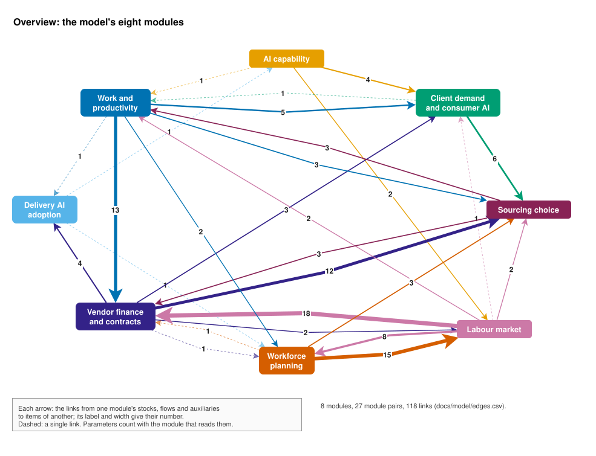

_The eight modules and the 27 module pairs that one module's stocks, flows and auxiliaries link to another's items (118 links). The label and width give the number of links; a dashed arrow is a single link._

### The article set

Five small diagrams for a reader outside the project. Every node stands for named items of the model and every link is a signed path in `docs/model/loops.csv` (the wording is in `src/aisim/data/model_articles.csv`).

#### A1. Why total IT jobs hold while their employer changes

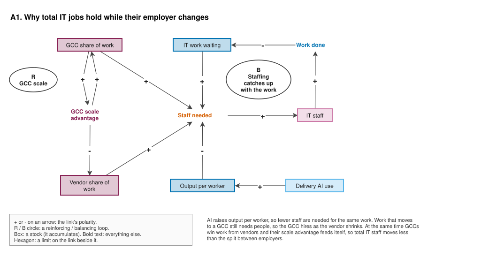

_AI raises output per worker, so fewer staff are needed for the same work. Work that moves to a GCC still needs people, so the GCC hires as the vendor shrinks. At the same time GCCs win work from vendors and their scale advantage feeds itself, so total IT staff moves less than the split between employers._

#### A2. The GCC scale loop

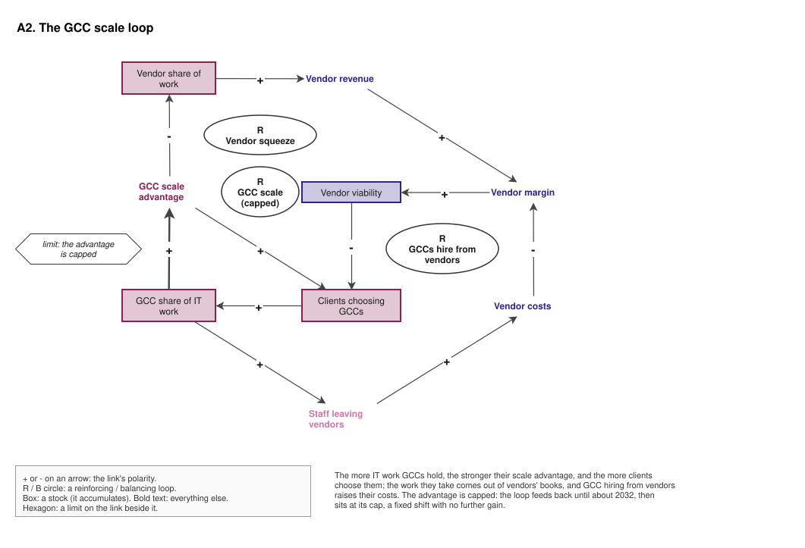

_The more IT work GCCs hold, the stronger their scale advantage, and the more clients choose them; the work they take comes out of vendors' books, and GCC hiring from vendors raises their costs. The advantage is capped: the loop feeds back until about 2032, then sits at its cap, a fixed shift with no further gain._

#### A3. Vendor distress and client flight

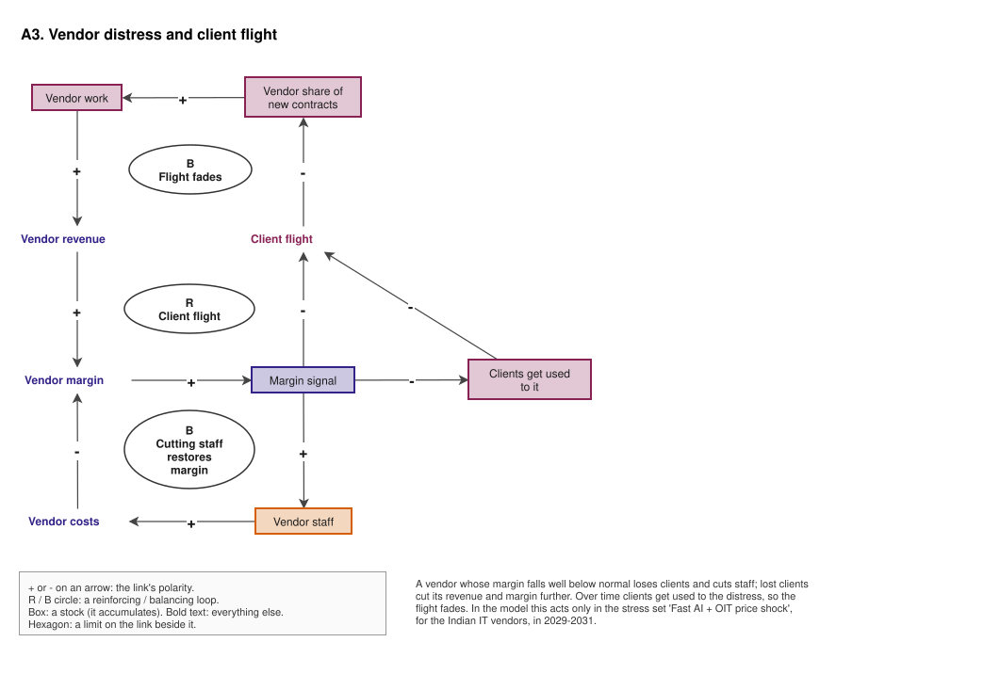

_A vendor whose margin falls well below normal loses clients and cuts staff; lost clients cut its revenue and margin further. Over time clients get used to the distress, so the flight fades. In the model it never acts in Base. It acts in short spells of about one to three years in five scenarios, mostly for the Indian IT vendors: the stress set 'Fast AI + OIT price shock', Compute shock, Visa relaxation, Jevons rebound and Demand boom._

#### A4. The pricing ceiling under fast AI

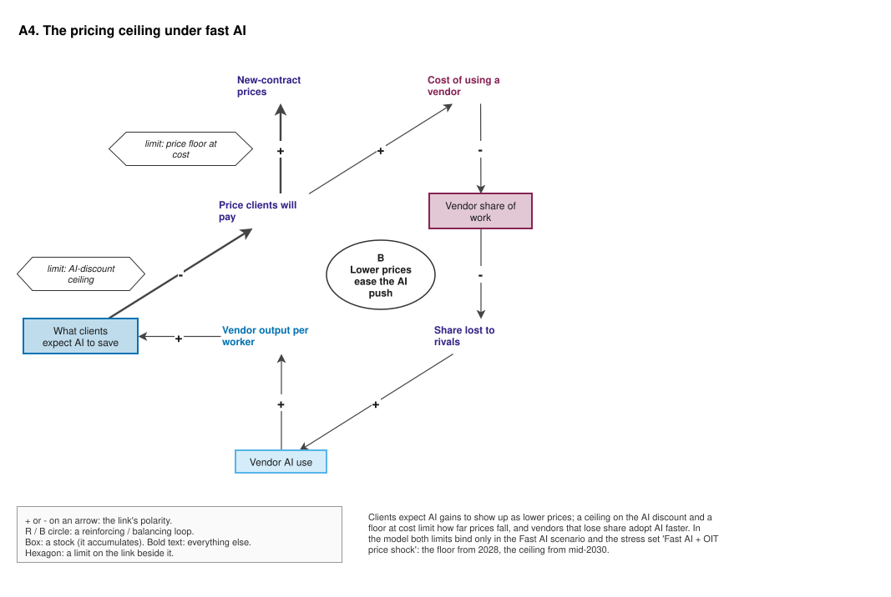

_Clients expect AI gains to show up as lower prices; a ceiling on the AI discount and a floor at cost limit how far prices fall, and vendors that lose share adopt AI faster. In the model both limits bind only in the Fast AI scenario and the stress set 'Fast AI + OIT price shock': the floor from 2028, the ceiling from mid-2030._

#### A5. Discouraged entry

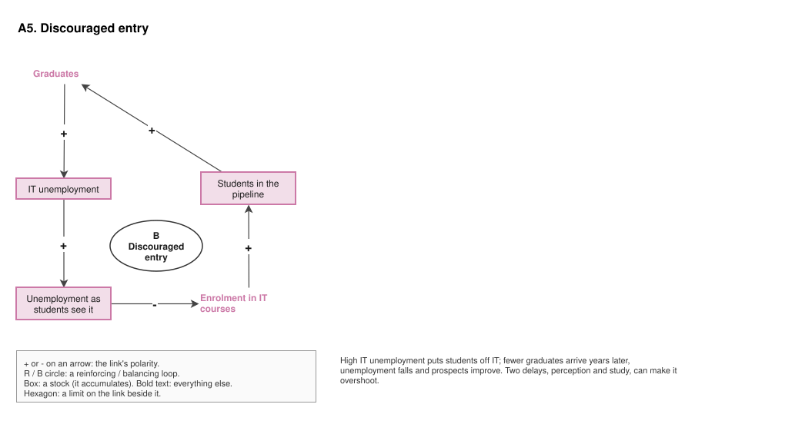

_High IT unemployment puts students off IT; fewer graduates arrive years later, unemployment falls and prospects improve. Two delays, perception and study, mean the correction arrives years late._

## Stocks

43 items.

| Name | Label | Description | Units | Dimensions | Module | Status |
| --- | --- | --- | --- | --- | --- | --- |
| `BL` | IT work backlog | IT work waiting to be done, by sector and work type, fed by demand and drained by completion and abandonment. | BFY | sector x worktype | work | reviewed |
| `ClientP` | Client-perceived productivity | Each employer's productivity relative to 2024 as its clients perceive it, lagging actual productivity and used in pricing and sourcing. | index (2024 = 1) | employer | work | reviewed |
| `ClientPRef` | Client reference productivity | A slower smoothing of client-perceived productivity, the trend reference against which clients price. | index (2024 = 1) | employer | work | reviewed |
| `PerceivedP` | Perceived productivity | Employers' perception of their own productivity relative to 2024, lagging actual productivity and used to size desired headcount. | index (2024 = 1) | employer | work | reviewed |
| `TightPerc` | Perceived visa tightness | The visa tightness employers perceive and act on, lagging the policy tightness. | dimensionless |  | workforce | reviewed |
| `Attr0` | 2024 voluntary attrition | Each vendor's 2024 voluntary exits per head a year, from quits, leaving the field and switch-outs, the R10 reference set on the first step. | fraction per year | vendor | labour_market | reviewed |
| `Dur0` | 2024 seeker spell | The 2024 expected job-seeker spell length by region and level, the R4 reference set on the first step. | years | region x level | labour_market | reviewed |
| `H` | Headcount | Employed IT staff by model unit and level, the core people stock of each employer and location. | model-unit persons | unit x level | labour_market | reviewed |
| `LeftField` | Left the field | A running total of people who have left the IT field, by region. | model-unit persons | region | labour_market | reviewed |
| `O` | Onboarding staff | New hires still ramping up before they count as productive headcount, by unit and level. | model-unit persons | unit x level | labour_market | reviewed |
| `Pipeline` | Student pipeline | Students in IT programmes who have not yet graduated, by region. | model-unit persons | region | labour_market | reviewed |
| `PUL` | Student-perceived unemployment | The unemployment rate as prospective students perceive it, smoothed over the student perception time, which drives enrolment, by region. | fraction | region | labour_market | reviewed |
| `PUS` | Worker-perceived unemployment | The unemployment rate as workers perceive it, smoothed over the unemployment perception time, which drives leaving the field and wages, by region. | fraction | region | labour_market | reviewed |
| `R` | Recovering after layoff | Recently laid-off people recovering before they search for IT work again, by region and level. | model-unit persons | region x level | labour_market | reviewed |
| `Retired` | Retired | A running total of people who have retired from IT employment or from the unemployed pools, by region. | model-unit persons | region | labour_market | reviewed |
| `U` | Job seekers | Active IT job seekers in each regional labour pool, by region and level. | model-unit persons | region x level | labour_market | reviewed |
| `V` | Vacancies | Open job slots waiting to be filled, by unit and level. | model-unit persons | unit x level | labour_market | reviewed |
| `CostProg` | Cost programme savings | The share of the vendor's labour cost saved by its cost programme, built up when its margin is below normal. | fraction | vendor | finance | reviewed |
| `Disc` | Competitive discount | The competitive discount the vendor gives on new signings, adjusting toward its target as it defends share or spends excess margin. | fraction | vendor | finance | reviewed |
| `ECost` | Expected delivery cost | The vendor's expected cost per unit of work relative to its base price, its cost index smoothed at the book's expiry rate, which the price floor reads. | dimensionless | vendor | finance | reviewed |
| `Leg` | Legacy contracts | Contracts in force at the 2024 start, by vendor and type, with no inflow, running off over their base durations. | book volume | vendor x type | finance | reviewed |
| `NewD` | Duration-weighted new book | The new contracts in force weighted by their terms, by vendor and type, a coflow whose ratio to new contract volume is their average term. | book volume-years | vendor x type | finance | reviewed |
| `NewP` | Price-weighted new book | The new contracts in force weighted by their price index, by vendor and type, a coflow whose ratio to new contract volume is their average price. | book volume | vendor x type | finance | reviewed |
| `NewV` | New contracts | Contracts signed since 2024, renewals included, still in force, by vendor and type. | book volume | vendor x type | finance | reviewed |
| `Overhead` | Vendor overhead | The vendor's yearly overhead cost, adjusting slowly toward a set share of its revenue. | USD per year | vendor | finance | reviewed |
| `ShareRef` | Reference work share | The work share the vendor regards as normal, a slow average of its actual share, against which its share loss is measured. | fraction | vendor | finance | reviewed |
| `Viab` | Vendor viability | The vendor's margin smoothed over ViabilityTime, the slow viability signal behind its discounts, cost programme, bargaining power and sourcing risk. | fraction | vendor | finance | reviewed |
| `VMarg` | Vendor margin signal | The vendor's margin smoothed over a short R6MargTime, starting from viability, whose ratio to normal margin is the relative viability that vendor stress terms read. | fraction | vendor | finance | reviewed |
| `WI` | Wage index | Each unit's wage level relative to its base wage, adjusting slowly toward its target. | index (2024 = 1) | unit | finance | reviewed |
| `C4Hab` | Habituated viability shortfall | Each vendor's relative-viability shortfall below the R6 threshold, smoothed over the fade time: the part of the distress clients have grown used to. | dimensionless | vendor | sourcing | reviewed |
| `GCCW` | GCC work share | The share of each sector's IT work held by global capability centres, the captive units of client firms. | fraction | sector | sourcing | reviewed |
| `IHW` | In-house work share | The share of each sector's IT work held by its own in-house teams. | fraction | sector | sourcing | reviewed |
| `SrcPerc` | Perceived sourcing shares | The perceived sourcing shares by sector and employer that allocate contested work, adjusting toward the sourcing targets with a delay. | fraction | sector x employer | sourcing | reviewed |
| `VW` | Vendor work share | The share of each sector's IT work held by each vendor under contract. | fraction | sector x vendor | sourcing | reviewed |
| `WS0` | 2024 GCC work share | The economy-wide GCC share of completed IT work in 2024, the reference of loop R7, held at -1 until the first step fills it. | fraction |  | sourcing | reviewed |
| `A` | Delivery AI adoption | The share of each employer's delivery work that uses AI, rising by Bass diffusion from its 2024 level, by employer. | fraction | employer | adoption | reviewed |
| `AC` | Consumer AI adoption | The share of each sector's consumers that have adopted AI in their own business. | fraction | sector | consumer | reviewed |
| `Att` | AI seat attach rate | The share of seats with an AI add-on, across all sectors; it shares its name with the auxiliary `Att` and the output `Att`. | fraction |  | consumer | reviewed |
| `CostPerc` | Perceived IT cost | Consumers' perceived cost per unit of IT work relative to 2024, following the services cost index with a delay. | index (2024 = 1) |  | consumer | reviewed |
| `LOB` | LOB headcount | Line-of-business (non-IT) staff of each consumer sector; not the output `LOB`, the all-sector total. | model-unit persons | sector | consumer | reviewed |
| `Port` | Application portfolio | The number of applications each consumer sector runs. | applications | sector | consumer | reviewed |
| `SeatsB` | Billed seats | Software seats each sector is billed for, following actual seats at device refresh and licence renewal. | seats | sector | consumer | reviewed |
| `SpendRatio` | Spend to budget ratio | Each sector's committed IT spend over its budget, smoothed over the budget cycle. | dimensionless | sector | consumer | reviewed |

## Flows

60 items.

| Name | Label | Description | Units | Dimensions | Module | Status |
| --- | --- | --- | --- | --- | --- | --- |
| `Aband` | Work abandonment | IT work dropped each year, by sector and work type, where its holders' completion rates fall short of what clients tolerate. | BFY per year | sector x worktype | work | reviewed |
| `Comp` | Work completion | IT work completed each year, by sector and work type, at the completion rates of the employers holding it. | BFY per year | sector x worktype | work | reviewed |
| `flow:ClientP` | Client perception change | The yearly adjustment of client-perceived productivity toward each employer's actual productivity over ClientPerceptionTime. | index (2024 = 1) per year | employer | work | drafted |
| `flow:ClientPRef` | Reference productivity change | The yearly adjustment of the client reference productivity toward client-perceived productivity over TrendTime. | index (2024 = 1) per year | employer | work | drafted |
| `flow:PerceivedP` | Perception change | The yearly adjustment of each employer's perceived productivity toward its actual productivity over PerceptionTime. | index (2024 = 1) per year | employer | work | drafted |
| `cancel` | Vacancy cancellations | Vacancies withdrawn each year because they exceed the shortfall, by unit and level, no faster than vacancies could be filled. | model-unit persons per year | unit x level | workforce | reviewed |
| `flow:TightPerc` | Tightness perception adjustment | The yearly adjustment of perceived visa tightness toward the policy tightness, over the tightness perception time. | dimensionless per year |  | workforce | drafted |
| `promo` | Promotions | Staff promoted into mid and senior roles each year, filling vacancies from the level below, by unit and level. | model-unit persons per year | unit x level | workforce | reviewed |
| `conv` | Visa conversions | Visa holders (OV) who convert to local onshore vendor staff (OL), at a rate reduced by visa tightness, by level. | model-unit persons per year | level | labour_market | reviewed |
| `Enrol` | Enrolment | Students entering IT programmes each year, growing with demand and cut by poor job prospects, by region. | model-unit persons per year | region | labour_market | reviewed |
| `expiry` | Visa expiries | Visa holders (OV) whose visas expire, leaving onshore employment for the India seeker pool, by level. | model-unit persons per year | level | labour_market | reviewed |
| `ext` | External entry | Experienced people entering the seeker pool from outside IT when time to fill exceeds normal, by region and level; zero for juniors. | model-unit persons per year | region x level | labour_market | reviewed |
| `fl.layoffs` | Layoffs | Staff laid off to remove a staffing surplus net of attrition, no faster than the minimum layoff time allows, by unit and level. | model-unit persons per year | unit x level | labour_market | reviewed |
| `fl.leave` | Leaving IT | Employed staff who leave the IT field altogether, by unit and level. | model-unit persons per year | unit x level | labour_market | reviewed |
| `fl.onboard` | Onboarding completions | New hires who finish onboarding and become productive headcount, by unit and level. | model-unit persons per year | unit x level | labour_market | reviewed |
| `fl.openings` | Vacancy openings | New vacancies opened to replace staff losses and close any staffing shortfall not already covered by open vacancies, by unit and level. | model-unit persons per year | unit x level | labour_market | reviewed |
| `fl.promo_out` | Promotions out | Staff promoted out of their level into the next level up in the same unit, by unit and level; zero for seniors. | model-unit persons per year | unit x level | labour_market | reviewed |
| `fl.quits` | Quits | Staff who leave their employer voluntarily to seek another IT job, by unit and level. | model-unit persons per year | unit x level | labour_market | reviewed |
| `fl.retire` | Retirements | Senior staff who retire from employment, by unit; zero for juniors and mids. | model-unit persons per year | unit x level | labour_market | reviewed |
| `flow:PUL` | Student perception change | The yearly adjustment of student-perceived unemployment towards the current unemployment rate, over the student perception time, by region. | fraction per year | region | labour_market | drafted |
| `flow:PUS` | Worker perception change | The yearly adjustment of worker-perceived unemployment towards the current unemployment rate, over the unemployment perception time, by region. | fraction per year | region | labour_market | drafted |
| `Grad` | Graduation | Students graduating from IT programmes into the junior seeker pool, by region. | model-unit persons per year | region | labour_market | reviewed |
| `hires` | Hires | Seekers hired into onboarding through the pool's matching of seekers and vacancies, capped by each unit's room and the visa cap, by unit and level. | model-unit persons per year | unit x level | labour_market | reviewed |
| `pool.rec_retire` | Recovering retirements | Senior recently laid-off people who retire, by region; zero for juniors and mids. | model-unit persons per year | region x level | labour_market | reviewed |
| `pool.rec_to_left` | Recovered, left field | Recently laid-off people who leave the IT field after recovering, a share that rises with perceived unemployment, by region and level. | model-unit persons per year | region x level | labour_market | reviewed |
| `pool.rec_to_seek` | Recovered to seeking | Recently laid-off people who finish recovering and start seeking IT work, by region and level. | model-unit persons per year | region x level | labour_market | reviewed |
| `pool.seek_exit` | Seeker exits | Job seekers who give up on IT and leave the field, scaled by the leave effect and, under R4, by spell length, by region and level. | model-unit persons per year | region x level | labour_market | reviewed |
| `pool.seek_retire` | Seeker retirements | Senior job seekers who retire, by region; zero for juniors and mids. | model-unit persons per year | region x level | labour_market | reviewed |
| `sw.in` | Switches in | Staff joining a unit directly from another unit in the same labour pool, drawn by relative wages and vacancies, by unit and level. | model-unit persons per year | unit x level | labour_market | reviewed |
| `sw.out` | Switches out | Staff leaving a unit directly for another unit in the same labour pool, the mirror of switches in, by unit and level. | model-unit persons per year | unit x level | labour_market | reviewed |
| `flow:CostProg` | Cost programme adjustment | The yearly change in cost programme savings as they move toward their target over CostProgramTime. | fraction per year | vendor | finance | drafted |
| `flow:Disc` | Discount adjustment | The yearly change in the competitive discount as it moves toward its target over DiscAdjTime. | fraction per year | vendor | finance | drafted |
| `flow:ECost` | Expected cost adjustment | The yearly change in the vendor's expected delivery cost as it moves toward the current cost index at the book's expiry rate. | dimensionless per year | vendor | finance | drafted |
| `flow:NewD` | Duration-weighted book change | The yearly change in the duration-weighted new book: signings times their terms, less the duration weight that expiring contracts take with them. | book volume-years per year | vendor x type | finance | drafted |
| `flow:NewP` | Price-weighted book change | The yearly change in the price-weighted new book: signings at their price, less expiries at the average price, less the price glide of contracts in force. | book volume per year | vendor x type | finance | drafted |
| `flow:Overhead` | Overhead adjustment | The yearly change in vendor overhead as it closes the gap to its target share of revenue over OverheadAdjTime. | USD per year per year | vendor | finance | drafted |
| `flow:ShareRef` | Reference share adjustment | The yearly change in the reference work share as it follows the vendor's actual share over ShareRefTime. | fraction per year | vendor | finance | drafted |
| `flow:Viab` | Viability adjustment | The yearly change in the viability index as it closes the gap to the current margin over ViabilityTime. | fraction per year | vendor | finance | drafted |
| `flow:VMarg` | Margin signal adjustment | The yearly change in the vendor margin signal as it closes the gap to the current margin over R6MargTime. | fraction per year | vendor | finance | drafted |
| `flow:WI` | Wage index adjustment | The yearly change in each unit's wage index as it moves toward its target over WageAdjTime. | index (2024 = 1) per year | unit | finance | drafted |
| `VB.Sign` | New signings | Contract volume the vendor signs each year, renewals plus wins, by contract type. | book volume per year | vendor x type | finance | reviewed |
| `VF.ExpLeg` | Legacy expiries | Legacy contracts in force since 2024 that expire each year, by vendor and type, running off over their base durations. | book volume per year | vendor x type | finance | reviewed |
| `VF.ExpNew` | New contract expiries | New contracts that expire each year, by vendor and type, over their average term in force. | book volume per year | vendor x type | finance | reviewed |
| `flow:C4Hab` | Habituation adjustment | The yearly adjustment of each vendor's habituated shortfall toward its current relative-viability shortfall, over the C4 fade time. | dimensionless per year | vendor | sourcing | drafted |
| `flow:SrcPerc` | Sourcing perception adjustment | The yearly adjustment of each perceived sourcing share toward its target, closing the gap over the sourcing perception time. | fraction per year | sector x employer | sourcing | drafted |
| `SignS` | Vendor signings | The share of each sector's work signed by each vendor each year: its renewed expiring work plus its perceived share of contested work. | fraction per year | sector x vendor | sourcing | reviewed |
| `Src.Contested` | Contested work | The share of each sector's work put out to sourcing choice each year: the contested part of reviewed in-house and GCC work and of expiring vendor work. | fraction per year | sector | sourcing | reviewed |
| `Src.GCCTurn` | GCC work review | The share of each sector's work held by GCCs that comes up for sourcing review each year. | fraction per year | sector | sourcing | reviewed |
| `Src.IHTurn` | In-house work review | The share of each sector's work held in house that comes up for sourcing review each year. | fraction per year | sector | sourcing | reviewed |
| `Src.VExp` | Vendor work expiry | The share of each sector's work held by each vendor whose contracts expire each year. | fraction per year | sector x vendor | sourcing | reviewed |
| `AdoptE` | Adoption rate | The yearly increase in each employer's delivery AI adoption, a Bass diffusion rate scaled by the cost, brake and push effects; zero with AI off. | fraction per year | employer | adoption | reviewed |
| `AttAdopt` | AI seat attach | The yearly rise in the share of seats with an AI add-on, by Bass diffusion; zero with AI off. | fraction per year |  | consumer | reviewed |
| `cons.AdoptC` | Consumer AI adoption rate | The yearly rise in each sector's consumer AI adoption, by Bass diffusion slowed by regulatory drag and sped by cost and reinvested savings. | fraction per year | sector | consumer | reviewed |
| `cons.NewApps` | New applications | Applications each sector adds to its portfolio a year, cut as AI agents displace new apps. | applications per year | sector | consumer | reviewed |
| `cons.Retire` | Application retirements | Applications each sector retires a year, sped up by AI exposure; applications, not people retiring. | applications per year | sector | consumer | reviewed |
| `Demand` | IT work demand | New IT work arriving each year by sector and work type, flowing into the backlog; not the output `Demand`, which is total demand. | BFY per year | sector x worktype | consumer | reviewed |
| `flow:CostPerc` | Perceived cost adjustment | The yearly change in consumers' perceived IT cost as it follows the services cost index. | index (2024 = 1) per year |  | consumer | drafted |
| `flow:LOB` | LOB headcount adjustment | The yearly change in each sector's line-of-business headcount as it closes the gap to its target, mostly through attrition. | model-unit persons per year | sector | consumer | drafted |
| `flow:SeatsB` | Billed seat adjustment | The yearly change in each sector's billed seats as they close the gap to actual seats. | seats per year | sector | consumer | drafted |
| `flow:SpendRatio` | Spend ratio adjustment | The yearly change in each sector's smoothed spend to budget ratio as it follows committed spend over budget. | dimensionless per year | sector | consumer | drafted |

## Auxiliaries

130 items.

| Name | Label | Description | Units | Dimensions | Module | Status |
| --- | --- | --- | --- | --- | --- | --- |
| `aW` | Automatable share | The share of each work type that AI can automate, closing part of its gap to the ceiling each year from its 2024 level. | fraction | worktype | capability | drafted |
| `G` | Demand growth multiplier | The underlying growth multiplier on base IT demand, budgets and graduate supply, 1 in 2024; shares its name with the output `G`, which records it. | index (2024 = 1) |  | capability | drafted |
| `PAI` | AI-assisted productivity | The productivity of fully AI-assisted work on each work type relative to unassisted work, by Amdahl's law with verification overhead. | multiplier | worktype | capability | drafted |
| `PAI0` | 2024 AI-assisted productivity | The productivity of fully AI-assisted work on each work type at 2024 capability, the reference that makes employer productivity 1 in 2024. | multiplier | worktype | capability | drafted |
| `Pew` | Employer work-type productivity | The productivity of each employer on each work type relative to 2024, blending AI-assisted and unassisted work by the employer's adoption; 1 with AI off. | index (2024 = 1) | employer x worktype | capability | drafted |
| `VerifNow` | Verification overhead | The current effort spent checking AI output per unit of automated work, falling as AI models become more reliable. | dimensionless |  | capability | drafted |
| `BLe` | Employer backlog | The IT work waiting that each employer holds, its work share of every sector's backlog. | BFY | employer | work | drafted |
| `BLs` | Sector backlog | The total IT work waiting in each sector, over all work types. | BFY | sector | work | drafted |
| `CapE` | Delivery capacity | The IT work each employer's effective staff could complete in a year at its current productivity. | BFY per year | employer | work | drafted |
| `CompE` | Employer work completed | The IT work each employer completes a year, its capacity capped by clearing its backlog in MinCompletionTime. | BFY per year | employer | work | drafted |
| `Completion` | Total work completed | Total IT work completed a year by all employers; shares its name with the output `Completion`, which records it. | BFY per year |  | work | drafted |
| `CompS` | Sector work completed | IT work completed a year in each sector, by all employers and work types. | BFY per year | sector | work | drafted |
| `CS` | Sector completion share | Each sector's share of all completed IT work, or its base sector share when nothing completes. | fraction | sector | work | drafted |
| `EffE` | Employer backlog effort | The effort each employer needs to clear its backlog, with each work type deflated by the employer's productivity on it. | BFY | employer | work | drafted |
| `EffortDone` | Effort spent | The total effort spent a year on completed work, each employer's completion deflated by its productivity. | BFY per year |  | work | drafted |
| `EffStaffE` | Effective staff | Each employer's level-weighted staff in mid-level equivalents, counting onboarding staff at reduced productivity. | model-unit persons | employer | work | drafted |
| `EmpShare` | Employer work share | Each employer's share of each sector's IT work, read from the in-house, GCC and vendor sourcing stocks, by sector and employer. | fraction | sector x employer | work | drafted |
| `P_all` | Realised productivity | Realised delivery productivity over all employers relative to 2024, completion over effort; shares its name with the output `P_all`, which records it. | index (2024 = 1) |  | work | drafted |
| `Pe` | Employer productivity | Each employer's work-weighted delivery productivity relative to 2024, by employer; 1 when it holds no backlog. | index (2024 = 1) | employer | work | drafted |
| `RateE` | Employer completion rate | The fraction of its held backlog that each employer completes per year, applied to every sector and work type it serves. | fraction per year | employer | work | drafted |
| `TotBL` | Total backlog | Total IT work waiting, summed over all sectors and work types. | BFY |  | work | drafted |
| `avail` | Fill capacity | The vacancy fill capacity left after cancellations, by unit and level, which caps promotions, job switches and hires. | model-unit persons per year | unit x level | workforce | drafted |
| `denomE` | Effective staff per head | The average level weight per head of each employer's staff mix, which converts effective staff into heads. | weight | employer | workforce | drafted |
| `Desired` | Desired headcount | The headcount each unit wants at each level, its employer's desired effective staff split by unit share and level mix. | model-unit persons | unit x level | workforce | drafted |
| `DesiredE` | Desired effective staff | The effective staff each employer wants, enough to clear its backlog within the target clearance time at perceived productivity. | model-unit persons | employer | workforce | drafted |
| `dTight` | Tightness gap | Perceived visa tightness above its 2024 level, which drives OIT's offshore shift and local hiring. | dimensionless |  | workforce | drafted |
| `OnsiteShare` | OIT onsite share | The share of OIT's work done onsite, falling as perceived visa tightness rises above its 2024 level. | fraction |  | workforce | drafted |
| `ShareL` | Level mix | The share of each employer's staff at each level, with the junior share cut as delivery AI adoption rises above its 2024 level. | fraction | employer x level | workforce | drafted |
| `surplus` | Staff surplus | Staff in post plus onboarding minus desired headcount, by unit and level; negative when short. | model-unit persons | unit x level | workforce | drafted |
| `UnitIn` | Unit work share | Each model unit's share of its employer's work, splitting OIT into offshore, onsite visa and onsite local units and GSI into India and onshore. | fraction | unit | workforce | drafted |
| `VisaMix` | Onsite visa mix | The share of OIT's onsite roles staffed by visa holders, falling as perceived visa tightness rises. | fraction |  | workforce | drafted |
| `VisaTight` | Visa tightness | The visa policy tightness from 0 open to 1 closed, ramping from VTBase to VTEnd; shares its name with the output `VisaTight`, which records it. | dimensionless |  | workforce | drafted |
| `EnrolEffect` | Enrolment effect | A multiplier on enrolment that falls as student-perceived unemployment rises above its normal rate, held within 0.4-1.3, by region. | multiplier | region | labour_market | drafted |
| `LeaveEffect` | Leave effect | A multiplier on leaving the field and on seeker exits, rising with worker-perceived unemployment over its normal rate, held within 0.5-3, by region. | multiplier | region | labour_market | drafted |
| `R4Mult` | Skill erosion multiplier | The R4 skill-erosion multiplier on seeker exits, rising with the expected spell length relative to 2024, by region and level; 1 while R4 is off. | index (2024 = 1) | region x level | labour_market | drafted |
| `TTFr` | Time to fill | The time to fill vacancies in each regional labour pool, by level: pool vacancies over their yearly fills, with fills floored at one a year. | years | region x level | labour_market | drafted |
| `TTFratio` | Mid time-to-fill ratio | The mid-level time to fill of each regional labour pool over its normal value, a capacity-strain signal for sourcing and contract choice. | dimensionless | region | labour_market | drafted |
| `UnempRate` | IT unemployment rate | The IT unemployment rate of each regional labour pool: recovering and seeking people over the pool's employed, onboarding, recovering and seeking people. | fraction | region | labour_market | drafted |
| `VisaCap` | Visa cap | The most visa-holder (OV) hires allowed a year across all levels: the base cap reduced by visa tightness. | model-unit persons per year |  | labour_market | drafted |
| `AICostCons` | Consumer AI cost | Yearly cost of AI tooling on the work that in-house teams and GCCs deliver with AI, a part of consumer IT services spend. | USD per year |  | finance | drafted |
| `AICostPerUnit` | AI cost per unit | Cost in real US dollars of one unit of work performed by AI, falling each year from its 2024 level and raised during a compute shock. | USD per BFY |  | finance | drafted |
| `AIShockNow` | AI cost shock factor | The factor on AI cost per unit of work from a compute shock: AIShockMult inside the shock window and 1 outside it. | multiplier |  | finance | drafted |
| `capu` | Unit effective staff | Level-weighted staff of each employment unit, with onboarding staff at reduced productivity, used to split the employer's completed work across its units. | model-unit persons | unit | finance | drafted |
| `Delivered` | Work delivered | Work each employment unit delivers in a year, its employer's completed work split across the employer's units by effective staff. | BFY per year | unit | finance | drafted |
| `LabourCost` | Unit labour cost | Yearly labour cost of each employment unit, the pay of its employed and onboarding staff, in real US dollars. | USD per year | unit | finance | drafted |
| `Pass` | Gain pass-through share | The share of in-term AI productivity gains each contract type passes to the client: none for fixed price, all for effort-billed types, set shares for managed services and outcome-based. | fraction | type | finance | drafted |
| `RevenueTot` | Total vendor revenue | Total yearly revenue of the three vendors in real US dollars; shares its name with the output `RevenueTot`, which records this value. | USD per year |  | finance | drafted |
| `ServicesSpend` | Services spend | Consumers' yearly IT services spend: in-house and GCC labour, GCC overhead, vendor revenue and own AI cost; shares its name with the output `ServicesSpend`. | USD per year |  | finance | drafted |
| `VB.Afford` | Discount affordability | How far the vendor can afford to defend its share with price: its viability over its normal margin, kept between 0 and 1. | multiplier | vendor | finance | drafted |
| `VB.CostIdx` | Vendor cost index | The vendor's cost per unit of work relative to its base price per unit, which sets contract profits and, smoothed, the expected cost under the price floor. | dimensionless | vendor | finance | drafted |
| `VB.CostProgTarget` | Cost programme target | The share of labour cost the vendor's cost programme aims to save when its margin is below normal, capped at MaxSavings. | fraction | vendor | finance | drafted |
| `VB.DiscTarget` | Target discount | The competitive discount on new signings the vendor moves toward, set by share loss it can afford to fight and by margin above normal. | fraction | vendor | finance | drafted |
| `VB.EffortShare` | Effort-billed share | The share of the vendor's contract book billed by effort, time and materials plus staff augmentation, which brakes the vendor's AI adoption. | fraction | vendor | finance | drafted |
| `VB.Margin` | Vendor margin | The vendor's profit margin, revenue less total cost over revenue, the signal its viability index smooths. | fraction | vendor | finance | drafted |
| `VB.SalesCost` | Sales cost | The vendor's yearly cost of winning and renewing contracts, in proportion to its revenue and its signing rate. | USD per year | vendor | finance | drafted |
| `VB.ShareLoss` | Share loss | How far the vendor's work share has fallen below its reference share, relative to that reference, zero when at or above it. | fraction | vendor | finance | drafted |
| `VB.SignRate` | Signing rate | The share of the vendor's contract book signed each year, renewals plus wins, taken from its signings across sectors. | fraction per year | vendor | finance | drafted |
| `VB.TypeShare` | Signing type share | The share of the vendor's new signings that goes to each contract type, from a logit over client and vendor utilities. | fraction | vendor x type | finance | drafted |
| `VB.VendorCost` | Vendor total cost | The vendor's total yearly cost: net labour, visa, AI tooling, overhead and sales costs, plus the attrition cost when that loop is on. | USD per year | vendor | finance | drafted |
| `VB.VolAttr` | Voluntary attrition ratio | The vendor's voluntary exits per head, from quits, leaving the field and switch-outs, relative to their 2024 value. | index (2024 = 1) | vendor | finance | drafted |
| `VB.VShare` | Vendor work share | The vendor's share of all completed IT work across sectors. | fraction | vendor | finance | drafted |
| `VB.wv` | Vendor bargaining weight | The weight of the vendor's profit, against the client's utility, in the contract-type choice, rising with bargaining power and kept between 0.1 and 0.9. | weight | vendor | finance | drafted |
| `VF.AICost` | Vendor AI cost | The vendor's yearly cost of AI tooling on the share of its delivered work that AI performs. | USD per year | vendor | finance | drafted |
| `VF.Anchor` | Client price anchor | The price clients expect per unit of work for priced contracts after AI gains, relative to 2024, set by their perceived productivity and its trend. | index (2024 = 1) | vendor | finance | drafted |
| `VF.AvgDur` | Average new duration | The average term of the new contracts in force, by vendor and type, falling back to the current signing term while there are none. | years | vendor x type | finance | drafted |
| `VF.AvgIdx` | Book price index | The average price of the vendor's in-force contract book relative to 2024, with effort-billed contracts deflated by productivity. | index (2024 = 1) | vendor | finance | drafted |
| `VF.AvgP` | Average new price | The average price index of the new contracts in force, by vendor and type, falling back to the current signing price while there are none. | index (2024 = 1) | vendor x type | finance | drafted |
| `VF.BasePriceAvg` | Average base price | The vendor's average base price per unit of work, its units' prices weighted by their shares of its work. | USD per BFY | vendor | finance | drafted |
| `VF.BaseRev` | Base revenue | The vendor's yearly revenue at base unit prices, before the book's price index and any price shock. | USD per year | vendor | finance | drafted |
| `VF.Book` | Contract book | The vendor's whole contract book in force, legacy plus new contracts of every type, normalised so each vendor's 2024 book is 1. | book volume | vendor | finance | drafted |
| `VF.CeilBinds` | Discount ceiling binds | Marks a step where the AI-discount ceiling raises the vendor's client price anchor: 1 when it binds, 0 otherwise or while the ceiling is off. | flag (0 or 1) | vendor | finance | drafted |
| `VF.dev` | Margin deviation | How far the vendor's viability index sits above or below its normal margin, as a signed share of revenue. | fraction | vendor | finance | drafted |
| `VF.DevEff` | Effective margin deviation | The vendor's margin deviation beyond a deadband around normal, zero inside it, which drives discounts, cost programmes, wage restraint and sourcing risk. | fraction | vendor | finance | drafted |
| `VF.Disc` | Competitive discount | The vendor's competitive discount on new signings, as read from the stock `Disc` for this step. | fraction | vendor | finance | drafted |
| `VF.Dnew` | New contract duration | The term of contracts signed now, by vendor and type, shortened by expected price declines, lengthened by bargaining power and floored at MinDur. | years | vendor x type | finance | drafted |
| `VF.ExpRate` | Book expiry rate | The share of the vendor's contract book that expires each year, legacy and new contracts together. | fraction per year | vendor | finance | drafted |
| `VF.FloorBinds` | Price floor binds | Marks, by vendor and contract type, a step where the price floor raises the new-signing price: 1 when it binds, 0 otherwise or while the floor is off. | flag (0 or 1) | vendor x type | finance | drafted |
| `VF.Glide` | Price glide rate | The yearly rate at which the in-force price of managed-services and outcome-based contracts falls as their share of productivity gains passes to clients, zero for other types. | fraction per year | vendor x type | finance | drafted |
| `VF.IdxVol` | Price-weighted book | The vendor's contract book weighted by price, by type, with effort-billed types deflated by productivity; its total over the book is the book's price index. | book volume | vendor x type | finance | drafted |
| `VF.LabRaw` | Gross vendor labour cost | The vendor's yearly labour cost over its units before the savings of its cost programme. | USD per year | vendor | finance | drafted |
| `VF.nm` | Normal margin | The vendor's normal margin, the parameter `NormalMargin` for that vendor, against which its viability and contract profits are judged. | fraction | vendor | finance | drafted |
| `VF.PNew` | New-signing price | The price of contracts signed now per unit of book volume, by vendor and type, relative to 2024, after the competitive discount and any price floor. | index (2024 = 1) | vendor x type | finance | drafted |
| `VF.Power` | Bargaining power | The vendor's bargaining power with clients, 1 at normal margin, rising with margin above normal and kept between PowerMin and PowerMax. | index (2024 = 1) | vendor | finance | drafted |
| `VF.PU` | Price uncertainty | The yearly fall in cost per unit of work that clients expect from the trend in their perceived productivity of the vendor. | fraction per year | vendor | finance | drafted |
| `VF.Revenue` | Vendor revenue | The vendor's yearly revenue in real US dollars from the work it delivers, at the prices in its contract book, less any price shock. | USD per year | vendor | finance | drafted |
| `VF.shock` | Price shock | The share of the vendor's revenue lost to a one-off price shock from PriceShockYear on, zero before it. | fraction | vendor | finance | drafted |
| `VF.VendDel` | Vendor work delivered | Work the vendor delivers in a year, summed over its employment units. | BFY per year | vendor | finance | drafted |
| `VF.Vi` | Vendor viability | The vendor's viability index, its margin smoothed over ViabilityTime, as read from the stock `Viab` for this step. | fraction | vendor | finance | drafted |
| `VF.VisaCost` | Visa cost | The vendor's yearly visa fees on onsite visa hires plus compliance cost on onsite visa staff, nonzero only for OIT. | USD per year | vendor | finance | drafted |
| `VF.VLab` | Net vendor labour cost | The vendor's yearly labour cost over its units, net of the savings of its cost programme. | USD per year | vendor | finance | drafted |
| `Wage` | Annual pay rate | Yearly pay per person by unit and level in real US dollars; shares its name with the parameter family `Wage`, the relative wage used in job switching. | USD per model-unit person per year | unit x level | finance | drafted |
| `WITarget` | Wage index target | The wage index each unit's wages move toward, rising with labour-market tightness and, for vendors below normal margin, held down by wage restraint. | index (2024 = 1) | unit | finance | drafted |
| `AvgW` | Average level weight | The average level weight per head of the in-house and GCC options, their effective staff per head from the current level mix. | weight | employer(IH,GCC) | sourcing | drafted |
| `AvgWM` | Average wage multiplier | The headcount-weighted average level wage multiplier of the in-house and GCC options, from their current level mix. | multiplier | employer(IH,GCC) | sourcing | drafted |
| `ClientFlight` | Client flight | The sourcing value each vendor loses to client flight while its relative viability is below the R6 threshold, net of habituation and capped; zero while kViab is 0. | logit units | vendor | sourcing | drafted |
| `CostOpt` | Sourcing option cost | The cost per unit of work of each sourcing option as clients see it, from wages and AI cost for in-house and GCC and from prices for vendors. | USD per BFY | employer | sourcing | drafted |
| `GCCScaleTerm` | GCC scale learning | The R7 term added to every sector's GCC sourcing value, rising with the economy-wide GCC work share over 2024; shares its name with the output `GCCScaleTerm`. | logit units |  | sourcing | drafted |
| `RiskOpt` | Sourcing option risk | The risk term of each sourcing option's value: vendor viability and exit risk, OIT visa risk and, under loop R6, client flight; zero for in-house and GCC. | logit units | employer | sourcing | drafted |
| `SrcTarget` | Sourcing target share | The target share of each sector's contested work for each employer, the logit choice over the sourcing values, toward which perceived shares move. | fraction | sector x employer | sourcing | drafted |
| `Val` | Sourcing value | The value (logit) of each employer option in each sector, from its constant, cost, risk, capacity and regulatory fit, plus appeal and scale terms for GCC. | logit units | sector x employer | sourcing | drafted |
| `Vrel` | Relative viability | Each vendor's margin smoothed over 0.75 years relative to its normal margin, 1 in 2024 and the signal of the R6 capacity exit and client flight. | index (2024 = 1) | vendor | sourcing | drafted |
| `brake` | T&M adoption brake | The multiplier that slows a vendor's AI adoption in proportion to the effort-billed share of its contract book; 1 for in-house and GCC. | multiplier | employer | adoption | drafted |
| `CEe` | Adoption cost effect | The multiplier on each employer's adoption speed from its labour cost and the AI cost, both relative to 2024, bounded by CEMin and CEMax. | multiplier | employer | adoption | drafted |
| `labpb` | Labour cost per capacity | Each employer's labour cost per unit of effective staff capacity, the dearer-labour signal that speeds its delivery AI adoption. | USD per model-unit person per year | employer | adoption | drafted |
| `push` | Share-loss adoption push | The multiplier that speeds a vendor's AI adoption when it is losing work share; 1 for in-house and GCC. | multiplier | employer | adoption | drafted |
| `Att` | AI seat attach rate | The step's copy of the share of seats with an AI add-on; it shares its name with the stock `Att` and the output `Att`. | fraction |  | consumer | drafted |
| `BudgetGrowth` | Budget growth factor | The factor that grows each sector's 2024 IT budget with the economy and IT budget growth, less any budget shock. | multiplier |  | consumer | drafted |
| `CEc` | Consumer cost effect | The factor by which AI credit cost below or above its 2024 level speeds or slows consumer AI adoption, bounded by CEMin and CEMax. | multiplier |  | consumer | drafted |
| `CloudPB` | Cloud spend per unit | Consumer cloud spend per unit of completed IT work, rising as AI does more of the work. | USD per BFY |  | consumer | drafted |
| `cons.AgentWork` | Agent work | The line-of-business work done by AI agents in each sector a year, equal to the LOB headcount automated away. | BFY per year | sector | consumer | drafted |
| `cons.AIBuild` | AI build demand | Each sector's yearly IT work demand for building and running AI, from consumer adoption above its 2024 pace. | BFY per year | sector | consumer | drafted |
| `cons.Approval` | Demand approval | The share of each sector's app, data and AI build demand approved, falling once smoothed committed spend exceeds the budget (loop B11). | fraction | sector | consumer | drafted |
| `cons.Budget` | Consumer IT budget | Each sector's yearly IT budget: its grown 2024 budget plus a share of positive net LOB savings reinvested. | USD per year | sector | consumer | drafted |
| `cons.CloudSpend` | Cloud spend | Each sector's yearly consumer cloud spend on the IT work it completes. | USD per year | sector | consumer | drafted |
| `cons.Committed` | Committed IT spend | Each sector's yearly committed IT spend: its share of services spend plus seats, AI credits and cloud. | USD per year | sector | consumer | drafted |
| `cons.CreditSpend` | AI credit spend | Each sector's yearly spend on AI credits for the agent work that replaces line-of-business staff. | USD per year | sector | consumer | drafted |
| `cons.LOBTarget` | LOB headcount target | The line-of-business headcount each sector would keep once AI exposure above 2024 has automated part of its work. | model-unit persons | sector | consumer | drafted |
| `cons.NetSavings` | Net LOB savings | Each sector's yearly line-of-business wage bill saved by AI, less what it spends on AI credits. | USD per year | sector | consumer | drafted |
| `cons.RegDrag` | Regulatory drag | The cut in each sector's consumer AI adoption speed from regulation, capped at 0.95; it also adds governance work and weighs on sourcing. | fraction | sector | consumer | drafted |
| `cons.Seats` | Actual seats | Each sector's seats in use: its line-of-business staff plus its share of consumer IT staff. | seats | sector | consumer | drafted |
| `cons.SeatSpend` | Seat spend | Each sector's yearly spend on billed seats, at the base seat price plus the AI add-on price on attached seats. | USD per year | sector | consumer | drafted |
| `ConsIT` | Consumer IT headcount | In-house and GCC IT staff, all levels, the consumers' own IT headcount, sharing its name with the output `ConsIT`. | model-unit persons |  | consumer | drafted |
| `CostIdx6` | Services cost index | Consumers' current services spend per unit of completed IT work, relative to its 2024 level. | index (2024 = 1) |  | consumer | drafted |
| `CreditCostPB` | AI credit cost | The AI credit cost of one baseline FTE-year of agent work, falling with AI cost decline and scaled by any AI cost shock. | USD per BFY |  | consumer | drafted |
| `CyberMult` | Cyber demand multiplier | The factor on security work demand, ramping from 1 at CyberStart to CyberEnd at CyberRampEnd. | multiplier |  | consumer | drafted |
| `DemandTot` | Total IT demand | Total new IT work demand a year, summed over all sectors and work types. | BFY per year |  | consumer | drafted |
| `GCCAppeal` | GCC appeal | The time-driven pull towards GCCs in sourcing, ramping up to GCCAppealEnd then fading to GCCAppealKeep of it. | logit units |  | consumer | drafted |
| `Jev` | Jevons demand multiplier | The factor by which a fall in perceived IT cost raises app and data demand and AI build demand, capped at JevonsCap (loop R3). | multiplier |  | consumer | drafted |
| `LOBAuto` | LOB automatable share | The share of line-of-business work that AI can do, rising from its 2024 level towards a ceiling. | fraction |  | consumer | drafted |
| `RegRamp` | Regulation phase-in | How far regulation has phased in, rising from 0 at RegStart to 1 at RegEnd. | fraction |  | consumer | drafted |

## Parameters

217 items.

| Name | Label | Description | Units | Dimensions | Module | phase9 | phase9_highadoption | Differs in | Class | Lever | Status |
| --- | --- | --- | --- | --- | --- | --- | --- | --- | --- | --- | --- |
| `A0` | 2024 delivery adoption | Delivery AI adoption in 2024, the reference level against which employer productivity and the junior hiring share are measured. | fraction |  | capability | 0.35 | 0.35 |  | parameters.csv structural | no | drafted |
| `DemandGrowth` | Demand growth rate | The underlying yearly growth rate of IT demand, budgets and graduate supply until LateYear, about 3% real. | fraction per year |  | capability | 0.03 | 0.03 |  | parameters.csv structural | no | drafted |
| `DemandGrowthLate` | Late demand growth rate | The underlying yearly growth rate of IT demand after LateYear; empty means the same as DemandGrowth. | fraction per year |  | capability | None | None |  | parameters.csv structural | yes | reviewed |
| `g` | Capability growth rate | The fraction of the remaining gap between each work type's automatable share and its ceiling that AI capability closes each year. | fraction per year |  | capability | 0.1 | 0.1 |  | parameters.csv structural | yes | reviewed |
| `LateYear` | Late growth switch year | The calendar year at which underlying demand growth switches from DemandGrowth to DemandGrowthLate. | year |  | capability | 2026.5 | 2026.5 |  | parameters.csv structural | no | drafted |
| `Verif` | Initial verification overhead | The 2024 effort spent checking AI output per unit of automated work, which then falls at VerifDecline a year. | dimensionless |  | capability | 0.544427747780907 | 0.5214128807872301 | phase7, phase8, phase8_highadoption | fitted in phase7, phase8, phase8_highadoption, phase9, phase9_highadoption; parameters.csv structural | yes | reviewed |
| `VerifDecline` | Verification decline rate | The fraction of the verification overhead that disappears each year as AI models become more reliable. | fraction per year |  | capability | 0.05 | 0.05 |  | parameters.csv structural | yes | reviewed |
| `AbandonTime` | Abandonment time | The time over which work beyond the tolerated backlog is abandoned. | years |  | work | 1.0 | 1.0 |  | parameters.csv structural | no | drafted |
| `AbandonTolerance` | Abandonment tolerance | The backlog clients tolerate, in years of throughput, before excess work starts to be abandoned. | years |  | work | 1.5 | 1.5 |  | parameters.csv structural | no | drafted |
| `ClientPerceptionTime` | Client perception time | The time clients take to notice changes in their supplier's productivity. | years |  | work | 1.5 | 1.5 |  | parameters.csv structural | no | drafted |
| `MinCompletionTime` | Minimum completion time | The shortest time in which any backlog can be cleared, which caps each employer's completion. | years |  | work | 0.25 | 0.25 |  | parameters.csv structural | no | drafted |
| `OnboardProductivity` | Onboarding productivity | The output of onboarding staff relative to fully productive staff. | fraction |  | work | 0.5 | 0.5 |  | parameters.csv structural | no | drafted |
| `PerceptionTime` | Perception time | The time employers take to recognise a change in their productivity, the lag in perceived productivity. | years |  | work | 1.0 | 1.0 |  | parameters.csv structural | no | drafted |
| `TrendTime` | Trend time | The window over which client-perceived productivity is smoothed to measure its trend. | years |  | work | 2.0 | 2.0 |  | parameters.csv structural | no | drafted |
| `W` | Level weight | The output of a junior, mid-level or senior person relative to a mid-level person, by level. | weight | level | work | J=0.6;M=1.0;S=1.4 | J=0.6;M=1.0;S=1.4 |  | parameters.csv structural | no | drafted |
| `WorkPerPerson` | Work per person | The IT work one effective person completes a year at baseline productivity. | BFY per model-unit person per year |  | work | 1.0 | 1.0 |  | parameters.csv structural | no | drafted |
| `CancelTime` | Vacancy cancel time | The time employers take to withdraw unneeded vacancies. | years |  | workforce | 0.25 | 0.25 |  | parameters.csv structural | no | drafted |
| `GSIOffshore` | GSI offshore share | The share of global systems integrator work delivered from India, the rest onshore. | fraction |  | workforce | 0.5 | 0.5 |  | parameters.csv structural | no | drafted |
| `JuniorCut` | Junior hiring cut | The cut in the junior share of staff per unit of delivery AI adoption above its 2024 level. | fraction |  | workforce | 0.7611256623040377 | 0.663415952721112 | phase7, phase8, phase8_highadoption | fitted in phase7, phase8, phase8_highadoption, phase9, phase9_highadoption; parameters.csv structural | yes | reviewed |
| `MinFillTime` | Minimum fill time | The fastest a vacancy can be filled, which caps cancellations, promotions and hires; it equals the time step. | years |  | workforce | 0.0625 | 0.0625 |  | parameters.csv structural | no | drafted |
| `OffshoreShiftSens` | Offshore shift sensitivity | How strongly OIT's onsite work moves offshore as perceived visa tightness rises. | dimensionless |  | workforce | 0.5 | 0.5 |  | parameters.csv structural | no | drafted |
| `OnsiteShare0` | Base onsite share | The share of OIT's work done onsite at 2024 visa tightness. | fraction |  | workforce | 0.25 | 0.25 |  | parameters.csv structural | no | drafted |
| `PromoFillTime` | Promotion fill time | How fast internal candidates fill vacancies at the mid and senior levels. | years |  | workforce | 0.125 | 0.125 |  | parameters.csv structural | no | drafted |
| `R6Cap` | Capacity exit cap | The largest fraction of a vendor's desired staff that loop C2 can cut. | fraction |  | workforce | 0.08 | 0.08 |  | set in phase9, phase9_highadoption; parameters.csv extension | no | drafted |
| `R6e` | Capacity exit strength | The strength of loop C2: the fraction of a vendor's desired staff cut per margin point of relative-viability shortfall below the R6 threshold. | fraction per margin point |  | workforce | 0.005 | 0.005 | phase7, phase8, phase8_highadoption | set in phase9, phase9_highadoption; parameters.csv extension | yes (structural) | reviewed |
| `Share0` | Base level mix | The level mix of staff without AI: the 2024 junior, mid and senior shares. | fraction | level | workforce | J=0.19;M=0.25;S=0.56 | J=0.19;M=0.25;S=0.56 |  | parameters.csv structural | no | drafted |
| `TargetClearanceTime` | Target clearance time | The time in which employers aim to clear their backlog, which sets their desired staff. | years |  | workforce | 0.5 | 0.5 |  | parameters.csv structural | no | drafted |
| `TightPerceptionTime` | Tightness perception time | How long firms take to respond to a change in visa policy tightness. | years |  | workforce | 1.0 | 1.0 |  | parameters.csv structural | no | drafted |
| `TimeInJunior` | Time as junior | The time until a junior is eligible for promotion to mid level. | years |  | workforce | 3.0 | 3.0 |  | parameters.csv structural | no | drafted |
| `TimeInMid` | Time as mid | The time until a mid-level employee is eligible for promotion to senior. | years |  | workforce | 5.0 | 5.0 |  | parameters.csv structural | no | drafted |
| `VisaMix0` | Base visa mix | The share of OIT's onsite roles staffed by visa holders at 2024 visa tightness. | fraction |  | workforce | 0.6 | 0.6 |  | parameters.csv structural | no | drafted |
| `VisaMixSens` | Visa mix sensitivity | How strongly OIT switches onsite roles from visa holders to local hires as perceived visa tightness rises. | dimensionless |  | workforce | 0.8 | 0.8 |  | parameters.csv structural | no | drafted |
| `VTBase` | Base visa tightness | Visa tightness in 2024 and before the ramp, on a scale from 0 open to 1 closed. | dimensionless |  | workforce | 0.3 | 0.3 |  | parameters.csv structural | no | drafted |
| `VTEnd` | End visa tightness | Visa tightness after the ramp, on a scale from 0 open to 1 closed: the visa policy scenario lever. | dimensionless |  | workforce | 0.3 | 0.3 |  | parameters.csv structural | yes | reviewed |
| `VTRampEnd` | Visa ramp end | The calendar year in which the visa tightness ramp ends. | year |  | workforce | 2031.0 | 2031.0 |  | parameters.csv structural | yes | reviewed |
| `VTRampStart` | Visa ramp start | The calendar year in which the visa tightness ramp starts. | year |  | workforce | 2027.0 | 2027.0 |  | parameters.csv structural | yes | reviewed |
| `alpha` | Matching seeker weight | The weight of seekers versus vacancies in the matching function, its exponent on seekers. | dimensionless |  | labour_market | 0.5 | 0.5 |  | parameters.csv structural | no | drafted |
| `BaseEnrolment` | Base enrolment | Students entering IT programmes a year at normal job prospects and 2024 demand, by region. | model-unit persons per year | region | labour_market | IN=3750.0;ON=3830.0 | IN=3750.0;ON=3830.0 |  | parameters.csv calibrated | no | drafted |
| `BaseLeaveFrac` | Base leave fraction | The share of recovering laid-off people who leave the IT field at normal job prospects, by level. | fraction | level | labour_market | J=0.05;M=0.1;S=0.2 | J=0.05;M=0.1;S=0.2 |  | parameters.csv structural | no | drafted |
| `BaseVisaCap` | Base visa cap | The visa-holder hires available a year at zero visa tightness. | model-unit persons per year |  | labour_market | 8000.0 | 8000.0 |  | parameters.csv structural | no | drafted |
| `Burn` | Burn-in switch | A calibration-only switch that, when on, grows the visa cap and the IT part of seats with demand growth during the burn-in. | switch |  | labour_market | 0.0 | 0.0 |  | parameters.csv structural | no | drafted |
| `ConvRate` | Visa conversion rate | The yearly fraction of visa holders who convert to permanent residence and local staff at zero visa tightness. | fraction per year |  | labour_market | 0.05 | 0.05 |  | parameters.csv structural | no | drafted |
| `EnrolSensitivity` | Enrolment sensitivity | The sensitivity of enrolment to student-perceived unemployment above its normal rate. | dimensionless |  | labour_market | 1.0 | 1.0 |  | parameters.csv structural | yes | reviewed |
| `ExtEntryMax` | External entry cap | The cap on the excess time-to-fill ratio that drives experienced external entry. | dimensionless |  | labour_market | 3.0 | 3.0 |  | parameters.csv structural | no | drafted |
| `ExtEntryRate` | External entry rate | The yearly rate of experienced entry from outside IT, as a share of pool headcount per unit of excess time to fill, for mid and senior levels. | fraction per year | level(M,S) | labour_market | M=0.05;S=0.05 | M=0.05;S=0.05 |  | parameters.csv structural | no | drafted |
| `HireAdjTime` | Hiring adjustment time | The time over which employers open vacancies to close a staffing shortfall. | years |  | labour_market | 0.5 | 0.5 |  | parameters.csv structural | no | drafted |
| `LayoffAdjTime` | Layoff adjustment time | The time over which employers close a staffing surplus through layoffs. | years |  | labour_market | 0.25 | 0.25 |  | parameters.csv structural | no | drafted |
| `LeaveITRate` | Leave-IT rate | The yearly fraction of each level's headcount that leaves the IT field altogether. | fraction per year | level | labour_market | J=0.05;M=0.06;S=0.04 | J=0.05;M=0.06;S=0.04 |  | parameters.csv structural | no | drafted |
| `m` | Matching efficiency | The efficiency of matching job seekers to vacancies in each labour pool, where recruiters and AI screening act. | dimensionless per year |  | labour_market | 4.0 | 4.0 |  | parameters.csv structural | no | drafted |
| `MinLayoffTime` | Minimum layoff time | The shortest time in which a unit's whole headcount could be laid off, which caps the layoff rate. | years |  | labour_market | 0.25 | 0.25 |  | parameters.csv structural | no | drafted |
| `MinSeekTime` | Minimum seek time | The shortest time in which the seeker pool could empty through exits, which caps the seeker exit rate while skill erosion is on. | years |  | labour_market | 0.25 | 0.25 |  | set in phase9, phase9_highadoption; parameters.csv extension | no | drafted |
| `NormalTTF` | Normal time to fill | The calibrated steady-state time to fill of each regional pool for mid and senior levels, the reference for external entry and the time-to-fill ratio. | years | region x level(M,S) | labour_market | IN/M=0.551;IN/S=0.286;ON/M=0.526;ON/S=0.079 | IN/M=0.551;IN/S=0.286;ON/M=0.526;ON/S=0.079 |  | parameters.csv calibrated | no | drafted |
| `NormalUnempRate` | Normal unemployment rate | The calibrated steady-state IT unemployment rate of each region, the reference for the leave and enrolment effects and for wages. | fraction | region | labour_market | IN=0.0502;ON=0.0553 | IN=0.0502;ON=0.0553 |  | parameters.csv calibrated | no | drafted |
| `OnboardTime` | Onboarding time | The time new hires take to ramp up before they count as productive headcount. | years |  | labour_market | 0.25 | 0.25 |  | parameters.csv structural | no | drafted |
| `OpeningsContinuous` | Continuous openings switch | An extension switch that, when on, lets openings taper smoothly to zero as overstaffing grows instead of stopping at the surplus sign change. | switch |  | labour_market | 1.0 | 1.0 | phase7 | set in phase8, phase8_highadoption, phase9, phase9_highadoption; parameters.csv extension | no | drafted |
| `QuitRate` | Quit rate | The yearly fraction of each level's headcount that quits to seek another IT job. | fraction per year | level | labour_market | J=0.15;M=0.1;S=0.08 | J=0.15;M=0.1;S=0.08 |  | parameters.csv structural | no | drafted |
| `R4a` | Onshore skill erosion | The strength of R4 skill erosion onshore: the largest proportional rise in the seeker exit rate for long spells, relative to 2024; 0 turns it off. | dimensionless |  | labour_market | 0.1 | 0.1 | phase7, phase8, phase8_highadoption | set in phase9, phase9_highadoption; parameters.csv extension | yes (structural) | reviewed |
| `R4aIN` | India skill erosion | The strength of R4 skill erosion in India: the largest proportional rise in the seeker exit rate for long spells, relative to 2024; 0 turns it off. | dimensionless |  | labour_market | 0.1 | 0.1 | phase7, phase8, phase8_highadoption | set in phase9, phase9_highadoption; parameters.csv extension | no | drafted |
| `RecoveryTime` | Recovery time | The time laid-off people take to recover before they search for work or leave the field. | years |  | labour_market | 0.33 | 0.33 |  | parameters.csv structural | no | drafted |
| `RetireRate_S` | Senior retirement rate | The yearly fraction of senior staff, and of senior recovering and seeking people, who retire. | fraction per year |  | labour_market | 0.033 | 0.033 |  | parameters.csv structural | no | drafted |
| `SeekerExitRate` | Seeker exit rate | The yearly fraction of job seekers who give up on IT at normal job prospects. | fraction per year |  | labour_market | 0.47612777754817076 | 0.46676771781498094 | phase7, phase8, phase8_highadoption | fitted in phase7, phase8, phase8_highadoption, phase9, phase9_highadoption; parameters.csv structural | no | reviewed |
| `StudentPerceptionTime` | Student perception time | The time over which prospective students' perception of unemployment catches up with the actual rate. | years |  | labour_market | 2.0 | 2.0 |  | parameters.csv structural | no | drafted |
| `StudyTime` | Study time | The length of study in an IT programme before graduation. | years |  | labour_market | 4.0 | 4.0 |  | parameters.csv structural | no | drafted |
| `SwitchElasticity` | Switching wage elasticity | The elasticity of job switching to the destination-to-source wage ratio. | dimensionless |  | labour_market | 2.0 | 2.0 |  | parameters.csv structural | no | drafted |
| `SwitchMax` | Switching wage-effect cap | The cap on the wage effect that scales job switching. | multiplier |  | labour_market | 2.0 | 2.0 |  | parameters.csv structural | no | drafted |
| `SwitchRate` | Job switch rate | The base yearly fraction of staff who switch directly to another unit in the same labour pool, before the wage effect. | fraction per year |  | labour_market | 0.04 | 0.04 |  | parameters.csv structural | no | drafted |
| `UnempPerceptionTime` | Unemployment perception time | The time over which workers' perception of unemployment catches up with the actual rate. | years |  | labour_market | 0.5 | 0.5 |  | parameters.csv structural | no | drafted |
| `VisaTenure` | Visa tenure | The average time before a visa holder's visa expires. | years |  | labour_market | 6.0 | 6.0 |  | parameters.csv structural | no | drafted |
| `Wage` | Relative wage | The relative wage of each unit within its labour pool, which steers job switching; not the finance auxiliary `Wage`, the yearly USD wage by unit and level. | dimensionless | unit | labour_market | IH=1.0;GCC=1.3;VI=1.0;OV=1.0;OL=0.95;SI_IN=1.1;SI_ON=1.05;BQ=1.1 | IH=1.0;GCC=1.3;VI=1.0;OV=1.0;OL=0.95;SI_IN=1.1;SI_ON=1.05;BQ=1.1 |  | parameters.csv structural | no | drafted |
| `AICost2024` | AI cost 2024 | The 2024 AI tooling and enablement cost per unit of work that AI saves, the starting level of AI cost per unit. | USD per BFY |  | finance | 45002.80306230147 | 40625.572434666574 | phase7, phase8, phase8_highadoption | fitted in phase7, phase8, phase8_highadoption, phase9, phase9_highadoption; parameters.csv structural | no | reviewed |
| `AICostDecline` | AI cost decline | The yearly fractional fall in AI cost per unit of work, which also drives the fall in consumer credit cost. | fraction per year |  | finance | 0.15 | 0.15 |  | parameters.csv structural | yes | reviewed |
| `AIDiscCeil` | AI discount ceiling | The largest AI discount clients can extract on new contract prices: the price anchor cannot fall below one minus it (loop R6, C6); 0 turns it off. | fraction |  | finance | 0.3 | 0.3 | phase7, phase8, phase8_highadoption | set in phase9, phase9_highadoption; parameters.csv extension | yes (structural) | reviewed |
| `AIShockEnd` | AI shock end | The calendar year the AI cost shock window closes; the shock no longer applies from this year on. | year |  | finance | 2032.0 | 2032.0 |  | parameters.csv structural | yes | reviewed |
| `AIShockMult` | AI cost shock multiplier | A test lever multiplying AI cost per unit inside the AI cost shock window, 1 for no shock. | multiplier |  | finance | 1.0 | 1.0 |  | parameters.csv structural | yes | reviewed |
| `AIShockStart` | AI shock start | The calendar year the AI cost shock window opens; the shock applies from this year up to, but not including, its end year. | year |  | finance | 2030.0 | 2030.0 |  | parameters.csv structural | yes | reviewed |
| `AnnuityAnchorW` | Annuity anchor exponent | The exponent of the client price anchor on the annuity part of new time-and-materials prices (the E2a annuity pricing term). | dimensionless |  | finance | 0.4 | 0.4 | phase7 | set in phase8, phase8_highadoption, phase9, phase9_highadoption; parameters.csv extension | no | drafted |
| `AnnuityShare` | Annuity share | The share of new time-and-materials signings that is annuity work and so carries the client price anchor (the E2a annuity pricing term). | fraction |  | finance | 0.3 | 0.3 | phase7 | set in phase8, phase8_highadoption, phase9, phase9_highadoption; parameters.csv extension | no | drafted |
| `BargainW0` | Base vendor weight | The vendor's weight in the contract-type choice at normal bargaining power, against the client's weight of one minus it. | weight |  | finance | 0.5 | 0.5 |  | parameters.csv structural | no | drafted |
| `BaseDur` | Base contract duration | The length of a new contract of each type without AI price pressure, also the length over which legacy contracts expire. | years | type | finance | FP=2.5;TM=1.5;MS=6.0;SA=1.0;OB=3.0 | FP=2.5;TM=1.5;MS=6.0;SA=1.0;OB=3.0 |  | parameters.csv structural | no | drafted |
| `BaseWage` | Base wage | The fully loaded yearly pay of a mid-level person in each employment unit at wage index 1, before the level multiplier. | USD per model-unit person per year | unit | finance | IH=125000.0;GCC=26000.0;VI=20000.0;OV=90000.0;OL=120000.0;SI_IN=22000.0;SI_ON=130000.0;BQ=140000.0 | IH=125000.0;GCC=26000.0;VI=20000.0;OV=90000.0;OL=120000.0;SI_IN=22000.0;SI_ON=130000.0;BQ=140000.0 |  | parameters.csv structural | no | drafted |
| `ConsSens` | Client utility sensitivity | The client's utility loss per unit of expected overpayment over a contract term, in the contract-type choice. | dimensionless |  | finance | 10.0 | 10.0 |  | parameters.csv structural | no | drafted |
| `CostProgramSens` | Cost programme sensitivity | The labour savings a vendor seeks per unit of viability shortfall below its normal margin, beyond the deadband. | dimensionless |  | finance | 1.5 | 1.5 |  | parameters.csv structural | no | drafted |
| `CostProgramTime` | Cost programme time | The time a vendor's cost programme takes to reach its savings target. | years |  | finance | 2.0 | 2.0 |  | parameters.csv structural | no | drafted |
| `Deadband` | Margin deadband | The deviation of a vendor's viability from its normal margin that is ignored before discounts, cost programmes and wage restraint respond. | fraction |  | finance | 0.02 | 0.02 |  | parameters.csv structural | no | drafted |
| `DiscAdjTime` | Discount adjustment time | The time a vendor's competitive discount takes to follow its target. | years |  | finance | 1.0 | 1.0 |  | parameters.csv structural | no | drafted |
| `DurPowerElast` | Duration power elasticity | The elasticity of new-contract length to vendor bargaining power. | dimensionless |  | finance | 1.0 | 1.0 |  | parameters.csv structural | no | drafted |
| `DurPUSens` | Duration price sensitivity | How strongly the expected yearly fall in cost per unit of work shortens new contracts. | years |  | finance | 15.0 | 15.0 |  | parameters.csv structural | no | drafted |
| `EffortDistrust` | Effort billing distrust | The share of perceived AI gains clients expect to lose under effort billing (time and materials, staff augmentation), a penalty in the contract-type choice. | fraction |  | finance | 0.5 | 0.5 |  | parameters.csv structural | no | drafted |
| `GCCOverhead` | GCC overhead | GCC management, facilities and setup cost as a fraction of GCC labour cost, added in services spend and the GCC sourcing cost. | fraction |  | finance | 0.5 | 0.5 |  | parameters.csv structural | no | drafted |
| `MaxDisc` | Maximum discount | The ceiling on a vendor's competitive discount on new signings. | fraction |  | finance | 0.4 | 0.4 |  | parameters.csv structural | no | drafted |
| `MaxSavings` | Maximum cost savings | The ceiling on the share of labour cost a vendor's cost programme can save. | fraction |  | finance | 0.15 | 0.15 |  | parameters.csv structural | no | drafted |
| `MinDur` | Minimum contract duration | The floor on new-contract length, which stops repricing pressure (loop R8) from driving terms to zero. | years |  | finance | 0.25 | 0.25 |  | parameters.csv structural | no | drafted |
| `MSGlideShare` | Managed services glide share | The share of in-term productivity gains that managed-services contracts pass to the client through glide paths. | fraction |  | finance | 0.5 | 0.5 |  | parameters.csv structural | no | drafted |
| `NormalMargin` | Normal vendor margin | Each vendor's steady-state margin, the reference for its margin responses and the denominator of relative viability. | fraction | vendor | finance | OIT=0.1844;GSI=0.1556;BQ=0.1256 | OIT=0.1844;GSI=0.1556;BQ=0.1256 |  | parameters.csv calibrated | no | drafted |
| `OBGainShare` | Outcome-based gain share | The share of in-term productivity gains that outcome-based contracts pass to the client. | fraction |  | finance | 0.5 | 0.5 |  | parameters.csv structural | no | drafted |
| `OverheadAdjTime` | Overhead adjustment time | The time a vendor's overhead takes to follow its target share of revenue. | years |  | finance | 2.0 | 2.0 |  | parameters.csv structural | no | drafted |
| `OverheadRate` | Overhead rate | Each vendor's steady-state overhead as a share of its revenue, the target its overhead stock moves toward. | fraction | vendor | finance | OIT=0.08;GSI=0.1;BQ=0.1 | OIT=0.08;GSI=0.1;BQ=0.1 |  | parameters.csv structural | no | drafted |
| `PassThrough` | Price pass-through | The exponent of the client price anchor: the share of client-perceived productivity gains passed into lower new-contract prices. | dimensionless |  | finance | 0.75 | 0.75 | phase7 | set in phase8, phase8_highadoption, phase9, phase9_highadoption; parameters.csv structural | no | drafted |
| `PowerMax` | Bargaining power ceiling | The upper limit on a vendor's bargaining power. | multiplier |  | finance | 1.2 | 1.2 |  | parameters.csv structural | no | drafted |
| `PowerMin` | Bargaining power floor | The lower limit on a vendor's bargaining power. | multiplier |  | finance | 0.5 | 0.5 |  | parameters.csv structural | no | drafted |
| `PowerSens` | Bargaining power sensitivity | The change in a vendor's bargaining power per unit of viability deviation from its normal margin. | dimensionless |  | finance | 3.0 | 3.0 |  | parameters.csv structural | no | drafted |
| `Price` | Unit price of work | The price a client pays per unit of work delivered by each vendor unit, before the vendor price multiplier and the contract price index. | USD per BFY | unit(VI,OV,OL,SI_IN,SI_ON,BQ) | finance | VI=39880.0;OV=150000.0;OL=150000.0;SI_IN=45000.0;SI_ON=170000.0;BQ=190000.0 | VI=39880.0;OV=150000.0;OL=150000.0;SI_IN=45000.0;SI_ON=170000.0;BQ=190000.0 |  | parameters.csv structural | no | drafted |
| `PriceFloor` | New-bid price floor | The floor on each new-bid price as a multiple of the vendor's expected cost per unit of work (loop R6); 0 turns it off. | multiplier |  | finance | 1.0 | 1.0 | phase7, phase8, phase8_highadoption | set in phase9, phase9_highadoption; parameters.csv extension | yes (structural) | reviewed |
| `PriceHorizon` | Client price horizon | The years of client-perceived productivity trend that clients price into the anchor for new contract prices. | years |  | finance | 6.999980575861419 | 6.999999999986844 | phase7, phase8, phase8_highadoption | fitted in phase7, phase8, phase8_highadoption, phase9, phase9_highadoption; parameters.csv structural | yes | reviewed |
| `PriceMult` | Vendor price multiplier | A calibrated factor on each vendor's unit prices that brings its 2024 margin to its target. | multiplier | vendor | finance | OIT=1.0154;GSI=1.036;BQ=1.0468 | OIT=1.0154;GSI=1.036;BQ=1.0468 |  | parameters.csv calibrated | no | drafted |
| `PriceShock` | Price shock | A test lever: the share of each vendor's revenue lost from the price-shock year onward, 0 by default. | fraction | vendor | finance | OIT=0.0;GSI=0.0;BQ=0.0 | OIT=0.0;GSI=0.0;BQ=0.0 |  | parameters.csv structural | no | drafted |
| `PriceShockYear` | Price shock year | The calendar year from which each vendor's price shock cuts its revenue. | year |  | finance | 2028.0 | 2028.0 |  | parameters.csv structural | no | drafted |
| `R10rc` | Attrition replacement cost | The years of wage a vendor pays to replace each voluntary exit above its 2024 attrition rate (loop R10); 0 turns it off. | years |  | finance | 0.1816 | 0.1816 | phase7, phase8, phase8_highadoption | set in phase9, phase9_highadoption; parameters.csv extension | yes (structural) | reviewed |
| `R6MargTime` | Margin signal time | The smoothing time of the vendor margin signal behind relative viability, read by the vendor-stress terms of loop R6. | years |  | finance | 0.75 | 0.75 |  | set in phase9, phase9_highadoption; parameters.csv extension | no | drafted |
| `R6Theta` | Viability stress threshold | The relative-viability threshold, as a fraction of the normal margin, below which vendor capacity exit and client flight begin (loop R6). | fraction |  | finance | 0.8 | 0.8 |  | set in phase9, phase9_highadoption; parameters.csv extension | yes (structural) | reviewed |
| `RivalSens` | Rival bidding sensitivity | The discount a vendor targets per unit of viability above its normal margin beyond the deadband, as rivals bid margins away. | dimensionless |  | finance | 3.0 | 3.0 |  | parameters.csv structural | no | drafted |
| `SalesCostRate` | Sales cost rate | Sales cost as a share of the yearly value of the contracts a vendor signs. | fraction |  | finance | 0.05 | 0.05 |  | parameters.csv structural | no | drafted |
| `SATTFSens` | Staff augmentation TTF sensitivity | The extra appeal of staff augmentation in the contract-type choice when onshore time to fill is above normal. | dimensionless |  | finance | 0.5 | 0.5 |  | parameters.csv structural | no | drafted |
| `ShareLossSens` | Share loss sensitivity | The discount a vendor targets per unit of relative work-share loss, while it can afford it (loop B12). | dimensionless |  | finance | 0.5 | 0.5 |  | parameters.csv structural | no | drafted |
| `ShareRefTime` | Reference share time | The time a vendor's idea of its normal work share takes to adapt to its actual share. | years |  | finance | 4.0 | 4.0 |  | parameters.csv structural | no | drafted |
| `TargetMargin` | Target margin | Each vendor's target 2024 margin, an input to the calibration only; the engine never reads it. | fraction | vendor | finance | OIT=0.18;GSI=0.15;BQ=0.12 | OIT=0.18;GSI=0.15;BQ=0.12 |  | parameters.csv unused | no | drafted |
| `TypeASC` | Contract type constant | The calibrated constant in each vendor's contract-type logit, set so the choice reproduces its 2024 signing shares, by vendor and contract type. | logit units | vendor x type | finance | OIT/FP=-1.2459;OIT/TM=-0.8893;OIT/MS=-2.5857;OIT/SA=-1.5824;OIT/OB=-3.885;GSI/FP=-1.0052;GSI/TM=-1.0409;GSI/MS=-2.1171;GSI/SA=-2.1171;GSI/OB=-3.2157;BQ/FP=-1.6232;BQ/TM=-0.7069;BQ/MS=-4.2905;BQ/SA=-1.2749;BQ/OB=-4.1081 | OIT/FP=-1.2459;OIT/TM=-0.8893;OIT/MS=-2.5857;OIT/SA=-1.5824;OIT/OB=-3.885;GSI/FP=-1.0052;GSI/TM=-1.0409;GSI/MS=-2.1171;GSI/SA=-2.1171;GSI/OB=-3.2157;BQ/FP=-1.6232;BQ/TM=-0.7069;BQ/MS=-4.2905;BQ/SA=-1.2749;BQ/OB=-4.1081 |  | parameters.csv calibrated | no | drafted |
| `VendSens` | Vendor utility sensitivity | The vendor's utility per unit of profit change relative to its normal margin, in the contract-type choice. | dimensionless |  | finance | 2.0 | 2.0 |  | parameters.csv structural | no | drafted |
| `ViabilityTime` | Viability smoothing time | The time over which a vendor's margin is smoothed into its viability index. | years |  | finance | 2.0 | 2.0 |  | parameters.csv structural | no | drafted |
| `VisaComplianceCost` | Visa compliance cost | The yearly legal and compliance cost per onsite visa (OV) head, charged to OIT only. | USD per model-unit person per year |  | finance | 5000.0 | 5000.0 |  | parameters.csv structural | no | drafted |
| `VisaFeePerHire` | Visa fee per hire | The one-off visa fee a vendor pays for each new onsite visa (OV) hire, charged to OIT only. | USD per model-unit person |  | finance | 100000.0 | 100000.0 |  | parameters.csv structural | no | drafted |
| `WageAdjTime` | Wage adjustment time | The time each unit's wage index takes to move toward its target. | years |  | finance | 2.0 | 2.0 |  | parameters.csv structural | no | drafted |
| `WageElasticity` | Wage elasticity | The elasticity of each unit's wage-index target to labour-market tightness, normal over perceived unemployment in its labour pool. | dimensionless |  | finance | 0.25 | 0.25 |  | parameters.csv structural | no | drafted |
| `WageMax` | Wage index ceiling | The ceiling on every unit's wage-index target. | index (2024 = 1) |  | finance | 1.3 | 1.3 |  | parameters.csv structural | no | drafted |
| `WageMin` | Wage index floor | The floor on every unit's wage-index target. | index (2024 = 1) |  | finance | 0.85 | 0.85 |  | parameters.csv structural | no | drafted |
| `WageMult` | Level pay multiplier | The pay of each staff level (junior, mid, senior) relative to mid level, applied to every unit's base wage. | multiplier | level | finance | J=0.6;M=1.0;S=1.5 | J=0.6;M=1.0;S=1.5 |  | parameters.csv structural | no | drafted |
| `WageRestraint` | Vendor wage restraint | The cut in a vendor unit's wage-index target per unit of viability shortfall below its normal margin, beyond the deadband. | dimensionless |  | finance | 1.0 | 1.0 |  | parameters.csv structural | no | drafted |
| `WagesEndogenous` | Endogenous wages switch | Model option: 1 lets each unit's wage index respond to unemployment and vendor margin pressure; 0 holds every wage index at 1. | switch |  | finance | 1.0 | 1.0 |  | parameters.csv structural | no | drafted |
| `C4Cap` | Client flight cap | The largest sourcing value a vendor can lose to client flight, with 0 meaning no cap. | logit units |  | sourcing | 0.0 | 0.0 |  | set in phase9, phase9_highadoption; parameters.csv extension | no | drafted |
| `C4FadeTime` | Client flight fade time | The time over which clients habituate to a vendor's viability shortfall, so client flight fades under constant distress. | years |  | sourcing | 2.0 | 2.0 |  | set in phase9, phase9_highadoption; parameters.csv extension | no | drafted |
| `CapSens` | Capacity penalty sensitivity | The sourcing value an option loses per unit by which its labour pool's time to fill exceeds normal. | logit units |  | sourcing | 0.5 | 0.5 |  | parameters.csv structural | no | drafted |
| `Contest` | Contested share | The share of reviewed or expiring work actually put out to sourcing choice; the rest stays with the incumbent. | fraction |  | sourcing | 0.5 | 0.5 |  | parameters.csv structural | no | drafted |
| `CostRef` | Reference sourcing cost | The 2024 in-house cost per unit of work, held fixed, against which option costs are scaled in the sourcing value. | USD per BFY |  | sourcing | 131000.0 | 131000.0 |  | parameters.csv calibrated | no | drafted |
| `ExitPenalty` | Exit risk penalty | The extra sourcing value a vendor loses per point of viability below the exit threshold. | logit units |  | sourcing | 7.5 | 7.5 |  | parameters.csv structural | no | drafted |
| `ExitThreshold` | Vendor exit threshold | The vendor viability (smoothed margin) below which clients treat the vendor as a going-concern risk. | fraction |  | sourcing | 0.0 | 0.0 |  | parameters.csv structural | no | drafted |
| `FreezeSourcing` | Freeze sourcing switch | A model option that, when on, stops the sourcing work shares and perceived sourcing shares from updating. | switch |  | sourcing | 0.0 | 0.0 |  | parameters.csv structural | no | drafted |
| `GCCAISens` | GCC AI sensitivity | The extra GCC sourcing value per unit of sector consumer AI adoption above its 2024 level. | logit units |  | sourcing | 0.5 | 0.5 |  | parameters.csv structural | no | drafted |
| `GCCMomentum` | GCC momentum | The logit tilt toward GCC applied to every sector's perceived sourcing shares at the start of the run, for the GCC build-out decided before 2024. | logit units |  | sourcing | 1.893980665357301 | 1.8622563942881671 | phase7, phase8, phase8_highadoption | fitted in phase7, phase8, phase8_highadoption, phase9, phase9_highadoption; parameters.csv structural | no | reviewed |
| `GCCReviewTime` | GCC review time | The average time between sourcing reviews of GCC work. | years |  | sourcing | 5.0 | 5.0 |  | parameters.csv structural | no | drafted |
| `IHReviewTime` | In-house review time | The average time between sourcing reviews of in-house work. | years |  | sourcing | 4.0 | 4.0 |  | parameters.csv structural | no | drafted |
| `kR7` | GCC scale learning strength | The strength of loop R7: the logit gain in every sector's GCC value per unit of log growth in the economy-wide GCC work share since 2024. | logit units |  | sourcing | 0.4 | 0.4 | phase7, phase8, phase8_highadoption | set in phase9, phase9_highadoption; parameters.csv extension | yes (structural) | reviewed |
| `kViab` | Client flight strength | The strength of loop C4: the sourcing value a vendor loses per unit of relative-viability shortfall not yet habituated. | logit units |  | sourcing | 5.8562 | 5.8562 | phase7, phase8, phase8_highadoption | set in phase9, phase9_highadoption; parameters.csv extension | yes (structural) | reviewed |
| `R7Lcap` | R7 log cap | The cap on the size of the log change in the GCC work share that loop R7 uses. | dimensionless |  | sourcing | 1.0 | 1.0 |  | set in phase9, phase9_highadoption; parameters.csv extension | no | drafted |
| `RegFitSens` | Regulatory fit sensitivity | The sourcing value an offshore option loses per unit of regulatory drag times consumer AI adoption times offshore exposure. | logit units |  | sourcing | 1.0 | 1.0 |  | parameters.csv structural | no | drafted |
| `SrcASC` | Sourcing option constant | The calibrated non-cost value of each employer option in each sector, such as proximity, control and setup barriers, with OIT as the zero reference. | logit units | sector x employer | sourcing | FIN/IH=0.3043;LEG/IH=1.7494;MED/IH=0.9228;GOV/IH=2.2727;MFG/IH=0.2986;LOG/IH=0.4809;RET/IH=0.4321;FIN/GCC=-2.1851;LEG/GCC=-3.535;MED/GCC=-3.1295;GOV/GCC=-3.8227;MFG/GCC=-2.7241;LOG/GCC=-3.1295;RET/GCC=-2.9552;FIN/OIT=0.0;LEG/OIT=0.0;MED/OIT=0.0;GOV/OIT=0.0;MFG/OIT=0.0;LOG/OIT=0.0;RET/OIT=0.0;FIN/GSI=0.2648;LEG/GSI=1.3353;MED/GSI=0.419;GOV/GSI=2.1054;MFG/GSI=0.0259;LOG/GSI=-0.0312;RET/GSI=-0.2742;FIN/BQ=1.2645;LEG/BQ=3.3927;MED/BQ=2.0064;GOV/BQ=2.9873;MFG/BQ=1.131;LOG/BQ=1.131;RET/BQ=0.859 | FIN/IH=0.3043;LEG/IH=1.7494;MED/IH=0.9228;GOV/IH=2.2727;MFG/IH=0.2986;LOG/IH=0.4809;RET/IH=0.4321;FIN/GCC=-2.1851;LEG/GCC=-3.535;MED/GCC=-3.1295;GOV/GCC=-3.8227;MFG/GCC=-2.7241;LOG/GCC=-3.1295;RET/GCC=-2.9552;FIN/OIT=0.0;LEG/OIT=0.0;MED/OIT=0.0;GOV/OIT=0.0;MFG/OIT=0.0;LOG/OIT=0.0;RET/OIT=0.0;FIN/GSI=0.2648;LEG/GSI=1.3353;MED/GSI=0.419;GOV/GSI=2.1054;MFG/GSI=0.0259;LOG/GSI=-0.0312;RET/GSI=-0.2742;FIN/BQ=1.2645;LEG/BQ=3.3927;MED/BQ=2.0064;GOV/BQ=2.9873;MFG/BQ=1.131;LOG/BQ=1.131;RET/BQ=0.859 |  | parameters.csv calibrated | no | drafted |
| `SrcCostSens` | Sourcing cost sensitivity | The sourcing value lost per unit of an option's cost relative to the reference cost. | logit units |  | sourcing | 3.0 | 3.0 |  | parameters.csv structural | yes | reviewed |
| `SrcPerceptionTime` | Sourcing perception time | The delay before perceived sourcing shares catch up with the sourcing targets. | years |  | sourcing | 1.5 | 1.5 |  | parameters.csv structural | no | drafted |
| `ViabSens` | Viability risk sensitivity | The sourcing value a vendor loses per point of weak viability beyond the dead band. | logit units |  | sourcing | 5.0 | 5.0 |  | parameters.csv structural | no | drafted |
| `VisaRiskSens` | Visa risk sensitivity | The sourcing value OIT loses per unit of perceived visa tightness above its 2024 level. | logit units |  | sourcing | 1.0 | 1.0 |  | parameters.csv structural | no | drafted |
| `AdoptMult` | Employer adoption multiplier | A per-employer multiplier on the Bass innovation rate p, so in-house teams start slower and boutiques faster. | multiplier | employer | adoption | IH=0.8;GCC=1.0;OIT=1.0;GSI=1.1;BQ=1.2 | IH=0.8;GCC=1.0;OIT=1.0;GSI=1.1;BQ=1.2 |  | parameters.csv structural | no | drafted |
| `CEMax` | Cost effect ceiling | The upper bound on the adoption cost effect, shared by delivery and consumer AI adoption. | multiplier |  | adoption | 1.5 | 1.5 |  | parameters.csv structural | no | drafted |
| `CEMin` | Cost effect floor | The lower bound on the adoption cost effect, shared by delivery and consumer AI adoption. | multiplier |  | adoption | 0.5 | 0.5 |  | parameters.csv structural | no | drafted |
| `CostAdoptElast` | Cost adoption elasticity | The elasticity of AI adoption speed to the ratio of labour cost to AI cost, shared by delivery and consumer AI adoption. | dimensionless |  | adoption | 0.3 | 0.3 |  | parameters.csv structural | no | drafted |
| `LabourCostPB0` | 2024 labour unit cost | Each employer's 2024 labour cost per unit of effective staff capacity, the reference level for the adoption cost effect. | USD per model-unit person per year | employer | adoption | IH=134270.0;GCC=27650.0;OIT=43680.0;GSI=82100.0;BQ=149090.0 | IH=134270.0;GCC=27650.0;OIT=43680.0;GSI=82100.0;BQ=149090.0 |  | parameters.csv calibrated | no | drafted |
| `p` | Bass innovation rate | The Bass innovation rate of delivery AI adoption, the yearly fraction of non-adopting work that adopts independently of existing adopters. | fraction per year |  | adoption | 0.24992454836537456 | 0.044 | phase7, phase8, phase8_highadoption | fitted in phase7, phase8, phase9; set in phase8_highadoption, phase9_highadoption; parameters.csv structural | no | reviewed |
| `PushSens` | Share-loss push sensitivity | The extra vendor AI adoption speed per unit of relative work-share loss. | dimensionless |  | adoption | 2.0 | 2.0 |  | parameters.csv structural | no | drafted |
| `q` | Bass imitation rate | The Bass imitation rate of delivery AI adoption, the yearly adoption pull per unit of existing adoption on the non-adopting share. | fraction per year |  | adoption | 0.06301873656009328 | 0.49345045457593956 | phase7, phase8, phase8_highadoption | fitted in phase7, phase8, phase8_highadoption, phase9, phase9_highadoption; parameters.csv structural | no | reviewed |
| `TMBrake` | T&M brake strength | How much a vendor's AI adoption speed falls per unit of effort-billed share of its contract book, the strength of the T&M paradox. | dimensionless |  | adoption | 0.4 | 0.4 |  | parameters.csv structural | yes | reviewed |
| `AC0` | 2024 consumer adoption | The 2024 share of firms scaling consumer AI, the level from which AI effects on LOB work, AI build and GCC value are measured. | fraction |  | consumer | 0.3 | 0.3 |  | parameters.csv structural | no | drafted |
| `AdoptC0` | 2024 consumer adoption rate | The consumer AI adoption rate already under way in 2024, derived from the Bass parameters, so AI build demand is zero in 2024. | fraction per year |  | consumer | 0.05323977586431476 | 0.05323892057923176 | phase7, phase8, phase8_highadoption | parameters.csv structural | no | drafted |
| `AISeatPrice` | AI seat add-on price | The yearly price of the AI add-on for one billed seat that has it. | USD per seat per year |  | consumer | 360.0 | 360.0 |  | parameters.csv structural | no | drafted |
| `aL_2024` | 2024 LOB automatable share | The share of line-of-business work that AI could automate in 2024. | fraction |  | consumer | 0.05 | 0.05 |  | parameters.csv structural | no | drafted |
| `aL_max` | Max LOB automatable share | The ceiling that the automatable share of line-of-business work approaches over time. | fraction |  | consumer | 0.35 | 0.35 |  | parameters.csv structural | yes | reviewed |
| `AppDisplacement` | App displacement strength | How strongly AI agents displace new application builds as AI exposure rises. | fraction |  | consumer | 0.6 | 0.6 |  | parameters.csv structural | no | drafted |
| `AppLife` | Application life | The average life of a business application, which sets the base rates of new builds and retirements. | years |  | consumer | 8.0 | 8.0 |  | parameters.csv structural | no | drafted |
| `ApprovalSens` | Approval sensitivity | The cut in approved discretionary demand per unit of overspend of the budget. | dimensionless |  | consumer | 2.0 | 2.0 |  | parameters.csv structural | no | drafted |
| `Att0` | 2024 seat attach | The 2024 share of seats with an AI add-on, kept for reference but never read by the engine. | fraction |  | consumer | 0.01 | 0.01 |  | parameters.csv unused | no | drafted |
| `BaseDemand` | Base IT demand | The yearly volume of new IT work arriving in 2024, before sector shares, growth and work-type mix. | BFY per year |  | consumer | 100000.0 | 100000.0 |  | parameters.csv structural | no | drafted |
| `BaseSeatPrice` | Base seat price | The yearly price of devices and per-seat software for one billed seat. | USD per seat per year |  | consumer | 1500.0 | 1500.0 |  | parameters.csv structural | no | drafted |
| `Budget0` | 2024 IT budget | The 2024 IT budget of each sector, grown each year and compared with committed IT spend. | USD per year | sector | consumer | FIN=3348000000.0;LEG=461800000.0;MED=1846800000.0;GOV=2650900000.0;MFG=2804800000.0;LOG=1319800000.0;RET=2955600000.0 | FIN=3348000000.0;LEG=461800000.0;MED=1846800000.0;GOV=2650900000.0;MFG=2804800000.0;LOG=1319800000.0;RET=2955600000.0 |  | parameters.csv calibrated | no | drafted |
| `BudgetCycle` | Budget cycle | The smoothing time of the ratio of committed spend to budget. | years |  | consumer | 1.0 | 1.0 |  | parameters.csv structural | no | drafted |
| `BudgetShock` | Budget shock | The fractional cut in IT budget growth during the budget shock window, a downturn lever. | fraction |  | consumer | 0.0 | 0.0 |  | parameters.csv structural | yes | reviewed |
| `BudgetShockEnd` | Budget shock end | The year the budget shock ends, excluded from the shock window. | year |  | consumer | 2032.0 | 2032.0 |  | parameters.csv structural | yes | reviewed |
| `BudgetShockStart` | Budget shock start | The year the budget shock begins. | year |  | consumer | 2030.0 | 2030.0 |  | parameters.csv structural | yes | reviewed |
| `BuildRate` | AI build rate | The AI project work generated per unit of consumer adoption flow above its 2024 rate, as a share of base demand. | dimensionless |  | consumer | 0.6 | 0.6 |  | parameters.csv structural | no | drafted |
| `CloudAISens` | Cloud AI sensitivity | How much cloud spend per unit of work rises as AI does more of the work. | dimensionless |  | consumer | 0.5 | 0.5 |  | parameters.csv structural | no | drafted |
| `CloudPerBFY` | Cloud spend per BFY | The 2024 cloud spend per unit of IT work completed, before the AI uplift. | USD per BFY |  | consumer | 13000.0 | 13000.0 |  | parameters.csv structural | no | drafted |
| `CostPerBFY0` | 2024 services cost | The 2024 consumer cost of IT services per unit of work completed, so the cost index is 1 in 2024. | USD per BFY |  | consumer | 104290.0 | 104290.0 |  | parameters.csv calibrated | no | drafted |
| `CostPerceptionTime` | Cost perception time | The delay before consumers notice changes in the cost of IT services work. | years |  | consumer | 1.5 | 1.5 |  | parameters.csv structural | no | drafted |
| `CreditCost2024` | 2024 AI credit cost | The 2024 cost in AI credits of one FTE-year of line-of-business work done by agents, falling over time with AI cost. | USD per BFY |  | consumer | 30000.0 | 30000.0 |  | parameters.csv structural | no | drafted |
| `CyberEnd` | Cyber demand end level | The multiplier on security demand from AI-driven cyber threats once the cyber ramp is complete; 1 means no change. | multiplier |  | consumer | 1.0 | 1.0 |  | parameters.csv structural | no | drafted |
| `CyberRampEnd` | Cyber ramp end | The year the cyber threat multiplier on security demand reaches its end level. | year |  | consumer | 2030.0 | 2030.0 |  | parameters.csv structural | no | drafted |
| `CyberStart` | Cyber ramp start | The year the cyber threat multiplier on security demand starts to ramp up. | year |  | consumer | 2026.0 | 2026.0 |  | parameters.csv structural | no | drafted |
| `DemandStep` | Demand step | A one-off proportional change in base demand from the step year onwards, used for testing. | fraction |  | consumer | 0.0 | 0.0 |  | parameters.csv structural | no | drafted |
| `GCCAppealEnd` | Peak GCC appeal | The extra sourcing value of GCCs reached at the end of the ramp, the size of the GCC wave. | logit units |  | consumer | 2.355142417513187 | 2.528152280404972 | phase7, phase8, phase8_highadoption | fitted in phase7, phase8, phase8_highadoption, phase9, phase9_highadoption; parameters.csv structural | no | reviewed |
| `GCCAppealKeep` | GCC appeal kept | The share of the peak GCC appeal that remains after the fade; 1 keeps the whole wave. | multiplier |  | consumer | 0.5 | 0.5 |  | parameters.csv structural | yes | reviewed |
| `GCCFadeEnd` | GCC fade end | The year the GCC appeal finishes fading to its kept share of the peak. | year |  | consumer | 2035.0 | 2035.0 |  | parameters.csv structural | no | drafted |
| `GCCRampEnd` | GCC ramp end | The year the extra GCC appeal reaches its full level and starts to fade. | year |  | consumer | 2030.0 | 2030.0 |  | parameters.csv structural | no | drafted |
| `GCCRampStart` | GCC ramp start | The year the extra appeal of GCCs starts to ramp up from zero. | year |  | consumer | 2024.0 | 2024.0 |  | parameters.csv structural | no | drafted |
| `GovRegSens` | Governance demand sensitivity | The extra governance work per unit of regulatory drag times consumer adoption. | dimensionless |  | consumer | 2.0 | 2.0 |  | parameters.csv structural | no | drafted |
| `ITBudgetGrowth` | IT budget growth | The real yearly growth rate of IT budgets, a macro lever on top of economic growth. | fraction per year |  | consumer | 0.0 | 0.0 |  | parameters.csv structural | no | drafted |
| `JevonsCap` | Jevons cap | The largest demand multiplier the Jevons effect can give app, data and AI build demand. | multiplier |  | consumer | 2.0 | 2.0 |  | parameters.csv structural | no | drafted |
| `JevonsEps` | Jevons elasticity | The elasticity of app and data demand to the perceived cost of IT work, the strength of the Jevons rebound; 0 switches it off. | dimensionless |  | consumer | 0.0 | 0.0 |  | parameters.csv structural | yes | reviewed |
| `Leakage` | Credit leakage | The share of AI credit spend that goes straight to AI model providers, kept from the spec but never read by the engine. | fraction |  | consumer | 0.2 | 0.2 |  | parameters.csv unused | no | drafted |
| `LOB0` | 2024 LOB headcount | The 2024 line-of-business headcount of each sector, the business staff whose work AI agents can automate. | model-unit persons | sector | consumer | FIN=189300.0;LEG=60600.0;MED=242300.0;GOV=287700.0;MFG=462500.0;LOG=217600.0;RET=557800.0 | FIN=189300.0;LEG=60600.0;MED=242300.0;GOV=287700.0;MFG=462500.0;LOG=217600.0;RET=557800.0 |  | parameters.csv calibrated | no | drafted |
| `LOBAdjTime` | LOB adjustment time | The time over which LOB headcount closes its gap to its target, mostly through attrition. | years |  | consumer | 2.0 | 2.0 |  | parameters.csv structural | no | drafted |
| `MigWeight` | Migration share of DATA | The share of data work driven by application retirements and migrations. | fraction |  | consumer | 0.3 | 0.3 |  | parameters.csv structural | no | drafted |
| `MinAdoptionTime` | Minimum adoption time | The shortest time in which an adoption fraction may close its gap to 1, a cap that keeps adoption at or below full. | years |  | consumer | 0.0625 | 0.0625 |  | parameters.csv structural | no | drafted |
| `MinApproval` | Minimum approval | The floor on the approval of discretionary IT demand, however far spend exceeds the budget. | fraction |  | consumer | 0.2 | 0.2 |  | parameters.csv structural | no | drafted |
| `NewAppWeight` | New-app share of APP | The share of app development work that builds new applications, the rest enhancing the existing portfolio. | fraction |  | consumer | 0.5 | 0.5 |  | parameters.csv structural | no | drafted |
| `NormalUtil` | Normal budget utilisation | The normal ratio of committed spend to budget, used in calibrating the 2024 budgets but never read by the engine. | fraction |  | consumer | 0.95 | 0.95 |  | parameters.csv unused | no | drafted |
| `pAtt` | Seat attach innovation | The Bass innovation rate of AI seat attach, the yearly fraction of seats without AI that add it unprompted. | fraction per year |  | consumer | 0.01225603738182102 | 0.012256000022936484 | phase7, phase8, phase8_highadoption | fitted in phase7, phase8, phase8_highadoption, phase9, phase9_highadoption; parameters.csv structural | no | reviewed |
| `pC` | Consumer adoption innovation | The Bass innovation rate of consumer AI adoption, the yearly fraction of non-adopting firms that adopt unprompted. | fraction per year |  | consumer | 0.005 | 0.005 |  | parameters.csv structural | no | drafted |
| `Port0` | 2024 application portfolio | The 2024 number of business applications in each sector's portfolio, the reference for new builds and portfolio-driven demand. | applications | sector | consumer | FIN=6310.0;LEG=757.0;MED=3029.0;GOV=4543.0;MFG=4291.0;LOG=2019.0;RET=4291.0 | FIN=6310.0;LEG=757.0;MED=3029.0;GOV=4543.0;MFG=4291.0;LOG=2019.0;RET=4291.0 |  | parameters.csv calibrated | no | drafted |
| `qAtt` | Seat attach imitation | The Bass imitation rate of AI seat attach, the yearly pull from seats that already have the AI add-on. | fraction per year |  | consumer | 0.5 | 0.5 |  | parameters.csv structural | no | drafted |
| `qC` | Consumer adoption imitation | The Bass imitation rate of consumer AI adoption, the yearly adoption pull from firms that already use AI. | fraction per year |  | consumer | 0.23685607554435603 | 0.2368520027582465 | phase7, phase8, phase8_highadoption | fitted in phase7, phase8, phase8_highadoption, phase9, phase9_highadoption; parameters.csv structural | no | reviewed |
| `RegEnd` | Regulation ramp end | The year regulatory drag on consumer AI adoption reaches its full level. | year |  | consumer | 2028.6 | 2028.6 |  | parameters.csv structural | no | drafted |
| `RegScenario` | Regulation scenario | The scenario multiplier on regulatory drag: 0 light-touch, 1 base, 1.5 strict. | multiplier |  | consumer | 1.0 | 1.0 |  | parameters.csv structural | yes | reviewed |
| `RegStart` | Regulation ramp start | The year regulatory drag on consumer AI adoption starts to ramp in. | year |  | consumer | 2027.9 | 2027.9 |  | parameters.csv structural | no | drafted |
| `ReinvestAdoptSens` | Reinvestment adoption boost | The extra speed of consumer AI adoption at full reinvestment of savings relative to the budget. | dimensionless |  | consumer | 0.5 | 0.5 |  | parameters.csv structural | no | drafted |
| `ReinvestFrac` | Reinvested savings share | The share of net LOB savings that firms add to their IT budget. | fraction |  | consumer | 0.2 | 0.2 |  | parameters.csv structural | no | drafted |
| `RetireAccel` | Retirement acceleration | The extra application retirement rate at full AI exposure, relative to the normal rate. | dimensionless |  | consumer | 1.0 | 1.0 |  | parameters.csv structural | no | drafted |
| `RunRate` | AI run rate | The ongoing work of running AI at full adoption above the 2024 level, as a share of base demand. | dimensionless |  | consumer | 0.1 | 0.1 |  | parameters.csv structural | no | drafted |
| `SeatAdjTime` | Seat adjustment time | The lag of billed seats behind actual seats, as refreshes and renewals catch up. | years |  | consumer | 2.0 | 2.0 |  | parameters.csv structural | no | drafted |
| `Seats0` | 2024 seats | The 2024 number of seats in each sector, LOB staff plus the sector's in-house and GCC IT staff, the reference for end-user support demand. | seats | sector | consumer | FIN=197814.0;LEG=61622.0;MED=246387.0;GOV=293832.0;MFG=468289.0;LOG=220324.0;RET=563589.0 | FIN=197814.0;LEG=61622.0;MED=246387.0;GOV=293832.0;MFG=468289.0;LOG=220324.0;RET=563589.0 |  | parameters.csv calibrated | no | drafted |
| `StepYear` | Demand step year | The calendar year from which the demand step applies. | year |  | consumer | 2028.0 | 2028.0 |  | parameters.csv structural | no | drafted |
| `SupPortShare` | Portfolio share of SUP | The share of support work that scales with the application portfolio. | fraction |  | consumer | 0.8 | 0.8 |  | parameters.csv structural | no | drafted |

## Tables

11 items.

| Name | Label | Description | Units | Dimensions | Module | phase9 | phase9_highadoption | Differs in | Class | Lever | Status |
| --- | --- | --- | --- | --- | --- | --- | --- | --- | --- | --- | --- |
| `a2024` | 2024 automatable share | The share of each work type that AI could automate in 2024, the starting point of the automatable share. | fraction | worktype | capability | APP=0.25;DATA=0.35;SEC=0.15;GOVN=0.1;SUP=0.3;EUS=0.35 | APP=0.25;DATA=0.35;SEC=0.15;GOVN=0.1;SUP=0.3;EUS=0.35 |  | set (baseline data) | no | drafted |
| `amax` | Automatable share ceiling | The ceiling that the automatable share of each work type approaches as AI capability grows. | fraction | worktype | capability | APP=0.6;DATA=0.8;SEC=0.45;GOVN=0.35;SUP=0.7;EUS=0.8 | APP=0.6;DATA=0.8;SEC=0.45;GOVN=0.35;SUP=0.7;EUS=0.8 |  | set (baseline data) | no | drafted |
| `SpeedUp` | AI speed-up | How many times faster AI performs the automatable part of each work type. | multiplier | worktype | capability | APP=5.0;DATA=5.0;SEC=4.0;GOVN=3.0;SUP=5.0;EUS=5.0 | APP=5.0;DATA=5.0;SEC=4.0;GOVN=3.0;SUP=5.0;EUS=5.0 |  | set (baseline data) | no | drafted |
| `Mix0` | 2024 contract mix | The 2024 share of each vendor's contract book in each contract type, by volume; the engine never reads it, as the baseline state already holds it. | fraction | vendor x type | finance | OIT/FP=0.35;OIT/TM=0.3;OIT/MS=0.22;OIT/SA=0.1;OIT/OB=0.03;GSI/FP=0.38;GSI/TM=0.22;GSI/MS=0.3;GSI/SA=0.05;GSI/OB=0.05;BQ/FP=0.3;BQ/TM=0.45;BQ/MS=0.05;BQ/SA=0.17;BQ/OB=0.03 | OIT/FP=0.35;OIT/TM=0.3;OIT/MS=0.22;OIT/SA=0.1;OIT/OB=0.03;GSI/FP=0.38;GSI/TM=0.22;GSI/MS=0.3;GSI/SA=0.05;GSI/OB=0.05;BQ/FP=0.3;BQ/TM=0.45;BQ/MS=0.05;BQ/SA=0.17;BQ/OB=0.03 |  | set (baseline data) | no | drafted |
| `OffExp` | Offshore exposure | Each employer option's degree of offshore delivery, which scales its regulatory-fit penalty in the sourcing value. | fraction | employer | sourcing | IH=0.0;GCC=0.3;OIT=0.8;GSI=0.5;BQ=0.0 | IH=0.0;GCC=0.3;OIT=0.8;GSI=0.5;BQ=0.0 |  | set (baseline data) | no | drafted |
| `Src0` | 2024 sourcing mix | The 2024 shares of each sector's work by employer, which the baseline state already holds; the engine never reads it. | fraction | sector x employer | sourcing | FIN/IH=0.22;FIN/GCC=0.18;FIN/OIT=0.35;FIN/GSI=0.2;FIN/BQ=0.05;LEG/IH=0.4;LEG/GCC=0.02;LEG/OIT=0.15;LEG/GSI=0.25;LEG/BQ=0.18;MED/IH=0.35;MED/GCC=0.06;MED/OIT=0.3;MED/GSI=0.2;MED/BQ=0.09;GOV/IH=0.45;GOV/GCC=0.01;GOV/OIT=0.1;GOV/GSI=0.36;GOV/BQ=0.08;MFG/IH=0.25;MFG/GCC=0.12;MFG/OIT=0.4;MFG/GSI=0.18;MFG/BQ=0.05;LOG/IH=0.3;LOG/GCC=0.08;LOG/OIT=0.4;LOG/GSI=0.17;LOG/BQ=0.05;RET/IH=0.3;RET/GCC=0.1;RET/OIT=0.42;RET/GSI=0.14;RET/BQ=0.04 | FIN/IH=0.22;FIN/GCC=0.18;FIN/OIT=0.35;FIN/GSI=0.2;FIN/BQ=0.05;LEG/IH=0.4;LEG/GCC=0.02;LEG/OIT=0.15;LEG/GSI=0.25;LEG/BQ=0.18;MED/IH=0.35;MED/GCC=0.06;MED/OIT=0.3;MED/GSI=0.2;MED/BQ=0.09;GOV/IH=0.45;GOV/GCC=0.01;GOV/OIT=0.1;GOV/GSI=0.36;GOV/BQ=0.08;MFG/IH=0.25;MFG/GCC=0.12;MFG/OIT=0.4;MFG/GSI=0.18;MFG/BQ=0.05;LOG/IH=0.3;LOG/GCC=0.08;LOG/OIT=0.4;LOG/GSI=0.17;LOG/BQ=0.05;RET/IH=0.3;RET/GCC=0.1;RET/OIT=0.42;RET/GSI=0.14;RET/BQ=0.04 |  | set (baseline data) | no | drafted |
| `BuildMix` | AI build mix | The split of AI project work across work types. | fraction | worktype | consumer | APP=0.35;DATA=0.35;SEC=0.1;GOVN=0.15;SUP=0.05;EUS=0.0 | APP=0.35;DATA=0.35;SEC=0.1;GOVN=0.15;SUP=0.05;EUS=0.0 |  | set (baseline data) | no | drafted |
| `LOBWage` | LOB wage | The blended yearly pay of one line-of-business employee in each sector, India and onshore together. | USD per model-unit person per year | sector | consumer | FIN=90000.0;LEG=85000.0;MED=65000.0;GOV=70000.0;MFG=55000.0;LOG=50000.0;RET=40000.0 | FIN=90000.0;LEG=85000.0;MED=65000.0;GOV=70000.0;MFG=55000.0;LOG=50000.0;RET=40000.0 |  | set (baseline data) | no | drafted |
| `RegDragLevel` | Regulatory drag level | Each sector's cut in consumer AI adoption speed once regulation fully applies, in the base scenario. | fraction | sector | consumer | FIN=0.3;LEG=0.2;MED=0.3;GOV=0.35;MFG=0.1;LOG=0.1;RET=0.05 | FIN=0.3;LEG=0.2;MED=0.3;GOV=0.35;MFG=0.1;LOG=0.1;RET=0.05 |  | set (baseline data) | no | drafted |
| `SectorShare` | Sector share of demand | Each sector's share of 2024 IT work, which splits base demand across sectors. | fraction | sector | consumer | FIN=0.25;LEG=0.03;MED=0.12;GOV=0.18;MFG=0.17;LOG=0.08;RET=0.17 | FIN=0.25;LEG=0.03;MED=0.12;GOV=0.18;MFG=0.17;LOG=0.08;RET=0.17 |  | set (baseline data) | no | drafted |
| `WTMix` | Work-type mix | The 2024 split of IT work across work types, the same in every sector. | fraction | worktype | consumer | APP=0.3;DATA=0.12;SEC=0.1;GOVN=0.05;SUP=0.33;EUS=0.1 | APP=0.3;DATA=0.12;SEC=0.1;GOVN=0.05;SUP=0.33;EUS=0.1 |  | set (baseline data) | no | drafted |

## Outputs

98 items.

| Name | Label | Description | Units | Dimensions | Module | Status |
| --- | --- | --- | --- | --- | --- | --- |
| `G` | Demand growth multiplier | The recorded underlying demand growth multiplier, 1 in 2024; shares its name with the auxiliary `G`, which it records. | index (2024 = 1) |  | capability | drafted |
| `Backlog` | Total backlog | The total IT backlog, summed over sectors and work types. | BFY |  | work | drafted |
| `CapE_{employer}` | Delivery capacity | The IT work each employer could complete a year at its current productivity and effective staff, an extra output. | BFY per year | employer | work | drafted |
| `CompE_{employer}` | Employer work completed | IT work completed a year by each employer. | BFY per year | employer | work | drafted |
| `Completion` | Total work completed | Total IT work completed a year by all employers; shares its name with the auxiliary `Completion`, which it records. | BFY per year |  | work | drafted |
| `CompS_{sector}` | Sector work completed | IT work completed a year in each sector by all employers. | BFY per year | sector | work | drafted |
| `P_all` | Realised productivity | Realised delivery productivity, completion over effort across employers, 1 in 2024; shares its name with the auxiliary `P_all`, which it records. | index (2024 = 1) |  | work | drafted |
| `P_{employer}` | Employer productivity | Each employer's work-weighted delivery productivity relative to 2024. | index (2024 = 1) | employer | work | drafted |
| `VendorWorkShare` | Vendor work share | The three vendors' combined share of all completed IT work, equal to one minus the in-house and GCC shares. | fraction |  | work | drafted |
| `WorkShare_{employer}` | Employer work share | Each employer's share of all completed IT work, its sector work shares weighted by each sector's share of completion. | fraction | employer | work | drafted |
| `VisaTight` | Visa tightness | The recorded visa policy tightness, from 0 open to 1 closed, ramping from VTBase to VTEnd; shares its name with the auxiliary `VisaTight` it records. | dimensionless |  | workforce | drafted |
| `Ext_total` | Total external entry | Experienced mid and senior entrants from outside IT a year, summed over both regions. | model-unit persons per year |  | labour_market | drafted |
| `Grad_total` | Total graduates | Graduates entering the junior seeker pools a year, summed over both regions. | model-unit persons per year |  | labour_market | drafted |
| `H_{unit}` | Unit headcount | Headcount of one employment unit over all levels, excluding onboarding staff. | model-unit persons | unit | labour_market | drafted |
| `Head_{employer}` | Employer headcount | Headcount of one employer, the sum of its units over all levels, excluding onboarding staff. | model-unit persons | employer | labour_market | drafted |
| `HeadLoc_{region}` | Headcount by location | Headcount located in one region, with visa holders counted onshore, equal to the consumer plus vendor Q1 lines of that region. | model-unit persons | region | labour_market | drafted |
| `HeadTotal` | Total IT headcount | All IT headcount across the eight units and three levels, equal to the sum of the four Q1 lines, excluding onboarding staff. | model-unit persons |  | labour_market | drafted |
| `HireJ_{region}` | Junior hires | Junior hires a year from one regional labour pool, summed over the units that hire from it. | model-unit persons per year | region x level | labour_market | drafted |
| `IndiaPeople` | India IT people | India IT employment in real people: the consumer and vendor India lines, each scaled by its own ratio to 2024, summed. | persons |  | labour_market | drafted |
| `IndiaPeople_ConsIndia` | India consumer IT people | The India consumer IT (GCC) line in real people: 1.90 million times its ratio to 2024. | persons |  | labour_market | drafted |
| `IndiaPeople_VendIndia` | India vendor IT people | The India vendor IT line in real people: 3.53 million times its ratio to 2024. | persons |  | labour_market | drafted |
| `IndiaTotal` | India headcount | India IT headcount: the consumer and vendor India Q1 lines combined, equal to headcount located in India. | model-unit persons |  | labour_market | drafted |
| `JuniorHiringRatio` | Junior hiring ratio | Junior hires from both labour pools relative to their 2024 value. | index (2024 = 1) |  | labour_market | drafted |
| `LeftField_{region}` | Left the field | A running total of people who have left the IT field, for one regional labour pool. | model-unit persons | region | labour_market | drafted |
| `OnshoreTotal` | Onshore headcount | Onshore IT headcount: the consumer and vendor onshore Q1 lines combined, equal to headcount located onshore. | model-unit persons |  | labour_market | drafted |
| `Q1_ConsIndia` | Consumer IT India | The Q1 line for consumer IT in India: GCC headcount. | model-unit persons |  | labour_market | drafted |
| `Q1_ConsOnshore` | Consumer IT onshore | The Q1 line for consumer IT onshore: in-house headcount. | model-unit persons |  | labour_market | drafted |
| `Q1_VendIndia` | Vendor IT India | The Q1 line for vendor IT in India: OIT and GSI India headcount. | model-unit persons |  | labour_market | drafted |
| `Q1_VendOnshore` | Vendor IT onshore | The Q1 line for vendor IT onshore: OIT visa holders and local staff, GSI onshore and BQ headcount. | model-unit persons |  | labour_market | drafted |
| `SkillErosionMult_{region}_{level}` | Skill erosion multiplier | The R4 skill-erosion multiplier on seeker exits for one region and level, relative to its 2024 value; 1 while that region's R4 strength is 0. | index (2024 = 1) | region x level | labour_market | drafted |
| `TTF_{region}_{level}` | Time to fill | Time to fill in one regional labour pool at one level: pool vacancies over yearly fills, with fills floored at one a year. | years | region x level | labour_market | drafted |
| `Unemp_{region}` | Unemployment rate | The IT unemployment rate of one regional labour pool, with visa holders counted in the India pool. | fraction | region | labour_market | drafted |
| `VendorHead` | Vendor headcount | Headcount of the three vendors OIT, GSI and BQ, equal to the two vendor Q1 lines combined. | model-unit persons |  | labour_market | drafted |
| `AICost_{vendor}` | Vendor AI cost | Each vendor's yearly AI tooling and enablement cost on the AI-automated share of its delivered work. | USD per year | vendor | finance | drafted |
| `AIDiscCeilBinds_{vendor}` | AI discount ceiling binds | 1 at a step where the loop R6 AI-discount ceiling raises a vendor's client price anchor, else 0; always 0 while the ceiling is off. | flag (0 or 1) | vendor | finance | drafted |
| `AvgIdx_{vendor}` | Book price index | The price index of each vendor's in-force contract book, 1 in 2024, with effort-billed types deflated by productivity. | index (2024 = 1) | vendor | finance | drafted |
| `AvgNewDur_{vendor}` | Average new duration | Each vendor's average new-contract duration, weighted by the contract-type shares of its new signings. | years | vendor | finance | drafted |
| `BaseRev_{vendor}` | Vendor base revenue | Each vendor's yearly revenue at base unit prices and its price multiplier, before the book price index and any price shock. | USD per year | vendor | finance | drafted |
| `Book_{vendor}_{type}` | Contract book | Each vendor's in-force contract book by type, legacy plus new, normalised so that its 2024 total book is 1. | book volume | vendor x type | finance | drafted |
| `Del_{unit}` | Work delivered by unit | Work delivered by each employment unit: its employer's completed work split over its units by effective staff. | BFY per year | unit | finance | drafted |
| `Disc_{vendor}` | Competitive discount | Each vendor's competitive price discount on new signings, which follows its target (loop B12). | fraction | vendor | finance | drafted |
| `Dnew_{vendor}_{type}` | New contract duration | The duration of each vendor's new contracts by type, shortened by price uncertainty and lengthened by bargaining power, floored at the minimum duration. | years | vendor x type | finance | drafted |
| `EffortShare_revenue_weighted` | Revenue-weighted effort share | The effort-billed share of the three vendors' contract books, averaged with vendor revenue as weights, since the volume books cannot be added across vendors. | fraction |  | finance | drafted |
| `EffortShare_{vendor}` | Effort-billed share | The effort-billed (time and materials plus staff augmentation) share of each vendor's in-force contract book, by volume. | fraction | vendor | finance | drafted |
| `ExpRate_{vendor}` | Expiry rate | Each vendor's yearly contract expiries (legacy plus new) per unit of its contract book. | fraction per year | vendor | finance | drafted |
| `LabCost_{unit}` | Unit labour cost | The yearly labour cost of each employment unit: wages paid on its headcount plus onboarding staff. | USD per year | unit | finance | drafted |
| `LabRaw_{vendor}` | Vendor gross labour cost | Each vendor's yearly gross labour cost, summed over its employment units before cost programme savings. | USD per year | vendor | finance | drafted |
| `Margin_{vendor}` | Vendor margin | Each vendor's margin: revenue less total cost, as a fraction of revenue. | fraction | vendor | finance | drafted |
| `Mix_{vendor}_{type}` | Contract mix | The share of each vendor's in-force contract book (legacy plus new) in each contract type, by volume, not value. | fraction | vendor x type | finance | drafted |
| `Overhead_{vendor}` | Vendor overhead | Each vendor's yearly overhead, a stock that lags its overhead rate times revenue. | USD per year | vendor | finance | drafted |
| `PNew_{vendor}_{type}` | New signing price | The price of each vendor's new signings by type per unit of book volume, relative to 2024, after the discount and the loop R6 price rules. | index (2024 = 1) | vendor x type | finance | drafted |
| `Power_{vendor}` | Bargaining power | Each vendor's bargaining power, 1 when its viability equals its normal margin and moving with the deviation, within the power floor and ceiling. | multiplier | vendor | finance | drafted |
| `PriceFloorBinds_{vendor}_{type}` | Price floor binds | 1 at a step where the loop R6 price floor raises a vendor's new-bid price for that contract type, else 0; always 0 while the floor is off. | flag (0 or 1) | vendor x type | finance | drafted |
| `PU_{vendor}` | Price uncertainty | Each vendor's price uncertainty: the client-perceived yearly productivity trend, the expected yearly fall in cost per unit of work. | fraction per year | vendor | finance | drafted |
| `Revenue_{vendor}` | Vendor revenue | Each vendor's yearly revenue in real terms: delivered work at base unit prices, times its book price index, less any price shock. | USD per year | vendor | finance | drafted |
| `RevenueTot` | Total vendor revenue | Total yearly revenue of the three vendor archetypes; shares its name with the auxiliary `RevenueTot` it records. | USD per year |  | finance | drafted |
| `SalesCost_{vendor}` | Vendor sales cost | Each vendor's yearly sales cost, a share of revenue scaled by its signing rate. | USD per year | vendor | finance | drafted |
| `ServicesSpend` | Services spend | Yearly consumer IT services spend: in-house and GCC labour cost (GCC with overhead), vendor revenue and consumers' own AI cost; shares its name with the auxiliary `ServicesSpend` it records. | USD per year |  | finance | drafted |
| `ShareLoss_{vendor}` | Work share loss | The relative shortfall of each vendor's work share below its reference share, 0 when at or above it. | fraction | vendor | finance | drafted |
| `Sign_{vendor}_{type}` | New signing type share | The logit share of each contract type in each vendor's new signings. | fraction | vendor x type | finance | drafted |
| `SignRate_{vendor}` | Signing rate | Each vendor's yearly signings (renewals plus wins) per unit of its contract book. | fraction per year | vendor | finance | drafted |
| `SignVol_{vendor}_{type}` | New signings volume | Each vendor's yearly new contract signings by type, in book volume. | book volume per year | vendor x type | finance | drafted |
| `VendDel_{vendor}` | Vendor work delivered | Work delivered by each vendor, summed over its employment units. | BFY per year | vendor | finance | drafted |
| `VendorCost_{vendor}` | Vendor total cost | Each vendor's total yearly cost: net labour, visa, AI, overhead and sales costs, plus attrition replacement cost when loop R10 is on. | USD per year | vendor | finance | drafted |
| `Vi_{vendor}` | Vendor viability | Each vendor's viability index: its margin smoothed over the viability time. | fraction | vendor | finance | drafted |
| `VisaCost_{vendor}` | Vendor visa cost | Each vendor's yearly visa fees on new onsite visa hires plus compliance cost on onsite visa staff, non-zero for OIT only. | USD per year | vendor | finance | drafted |
| `VLab_{vendor}` | Vendor net labour cost | Each vendor's yearly labour cost net of its cost programme savings. | USD per year | vendor | finance | drafted |
| `VoluntaryAttrition_{vendor}` | Voluntary attrition ratio | Each vendor's voluntary exits per head (quits, leaving the field and switch-outs) relative to 2024, the signal for loop R10's attrition cost. | index (2024 = 1) | vendor | finance | drafted |
| `VShare_{vendor}` | Vendor work share | Each vendor's share of all completed IT work, the same as its employer work share. | fraction | vendor | finance | drafted |
| `WI_{unit}` | Wage index | Each employment unit's wage index, 1 in 2024, adjusting toward a target set by labour-market tightness and vendor wage restraint. | index (2024 = 1) | unit | finance | drafted |
| `ClientFlight_{vendor}` | Client flight | The C4 client-flight term subtracted from each vendor's sourcing value, after the fade and the cap; zero while kViab is 0. | logit units | vendor | sourcing | drafted |
| `Cost_{employer}` | Sourcing cost by option | The sourcing cost per unit of work of each employer option as clients see it. | USD per BFY | employer | sourcing | drafted |
| `GCCScaleTerm` | GCC scale learning | The recorded R7 term added to every sector's GCC sourcing value, zero while kR7 is 0; shares its name with the auxiliary `GCCScaleTerm` it records. | logit units |  | sourcing | drafted |
| `Src_{sector}_{employer}` | Sourcing share | Each employer's share of each sector's IT work, from the in-house, GCC and vendor sourcing stocks. | fraction | sector x employer | sourcing | drafted |
| `SrcT_{sector}_{employer}` | Sourcing target share | The logit sourcing target share of each employer in each sector, toward which the perceived shares move. | fraction | sector x employer | sourcing | drafted |
| `Vrel_{vendor}` | Relative viability | Each vendor's margin smoothed over 0.75 years relative to its normal margin, the R6 signal of capacity exit and client flight. | index (2024 = 1) | vendor | sourcing | drafted |
| `WorkCheck_{sector}` | Sector work check | The sum of each sector's in-house, GCC and vendor work shares, a diagnostic that must stay at 1. | fraction | sector | sourcing | drafted |
| `WorkCheckMax` | Work check deviation | The largest deviation of any sector's work check from 1, a work conservation diagnostic that should stay near 0. | fraction |  | sourcing | drafted |
| `A_mean` | Mean delivery adoption | Delivery AI adoption averaged over employers, weighted by the work each completes. | fraction |  | adoption | drafted |
| `A_{employer}` | Delivery AI adoption | Delivery AI adoption of each employer, the recorded value of the adoption stock. | fraction | employer | adoption | drafted |
| `LabPB_{employer}` | Labour cost per capacity | Labour cost per unit of effective, level-weighted staff of each employer, which feeds the adoption cost effect. | USD per model-unit person per year | employer | adoption | reviewed |
| `AC_mean` | Mean consumer AI adoption | Consumer AI adoption averaged over sectors, weighted by base sector shares of demand rather than by completed work. | fraction |  | consumer | drafted |
| `AC_{sector}` | Consumer AI adoption | Consumer AI adoption of one sector, the share of its consumers using AI. | fraction | sector | consumer | drafted |
| `Att` | AI seat attach rate | The AI seat attach rate, the share of seats with an AI add-on; it shares its name with the stock `Att` and the auxiliary `Att`. | fraction |  | consumer | drafted |
| `Budget` | Total consumer budget | Consumer IT budget a year, all sectors, the grown base plus reinvested savings. | USD per year |  | consumer | drafted |
| `Budget_{sector}` | Consumer IT budget | Consumer IT budget of one sector a year. | USD per year | sector | consumer | drafted |
| `CloudSpend_{sector}` | Cloud spend | Consumer cloud spend of one sector a year, a part of its committed spend. | USD per year | sector | consumer | drafted |
| `Committed` | Total committed spend | Committed consumer IT spend a year, all sectors: services share, seats, AI credits and cloud. | USD per year |  | consumer | drafted |
| `Committed_{sector}` | Committed IT spend | Committed IT spend of one sector a year: services share, seats, AI credits and cloud. | USD per year | sector | consumer | drafted |
| `ConsIT` | Consumer IT headcount | Consumer IT headcount, in-house plus GCC, excluding onboarding staff; it shares its name with the auxiliary `ConsIT`. | model-unit persons |  | consumer | drafted |
| `CreditSpend_{sector}` | AI credit spend | Consumer AI credit spend of one sector a year, a part of its committed spend. | USD per year | sector | consumer | drafted |
| `Dem_{sector}` | Demand by sector | IT work demand of one sector a year, all work types. | BFY per year | sector | consumer | drafted |
| `Dem_{worktype}` | Demand by work type | IT work demand of one work type a year, all sectors. | BFY per year | worktype | consumer | drafted |
| `Demand` | Total IT demand | Total IT work demand a year, all sectors and work types; not the flow `Demand`, which is by sector and work type. | BFY per year |  | consumer | drafted |
| `LOB` | Total LOB headcount | Line-of-business (business) workforce, all sectors; not the stock `LOB`, which is by sector. | model-unit persons |  | consumer | drafted |
| `LOB_{sector}` | LOB headcount | Line-of-business headcount of one sector. | model-unit persons | sector | consumer | drafted |
| `SeatSpend_{sector}` | Seat spend | Consumer seat spend of one sector a year, a part of its committed spend. | USD per year | sector | consumer | drafted |
| `year` | Year | The calendar year of each recorded row, 2024 plus elapsed time, taken before that step's integration. | year |  | consumer | reviewed |

## Feedback-loop terms

The seven terms of `phase9`'s four feedback loops (`docs/model-changes-phase9.md`). Each is off at strength 0; the range is the evidence's low / base / high.

| Term | What | Strength in phase9 | Evidence range | Module | Design note |
| --- | --- | --- | --- | --- | --- |
| R7 | GCC scale learning | `kR7` 0.4 | 0.15 / 0.4 / 0.75 | sourcing | [model-changes-phase9.md:53](model-changes-phase9.md#L53) |
| C2 | R6 capacity exit | `R6e` 0.005 | 0.002 / 0.005 / 0.012 | workforce | [model-changes-phase9.md:93](model-changes-phase9.md#L93) |
| C4 | R6 client flight | `kViab` 5.8562 | 0 / 5.8562 / 10.6511 | sourcing | [model-changes-phase9.md:97](model-changes-phase9.md#L97) |
| C5 | R6 price floor | `PriceFloor` 1.0 | 0.85 / 1.00 / 1.08 | finance | [model-changes-phase9.md:108](model-changes-phase9.md#L108) |
| C6 | R6 AI-discount ceiling | `AIDiscCeil` 0.3 | 0.20 / 0.30 / 0.45 | finance | [model-changes-phase9.md:110](model-changes-phase9.md#L110) |
| R10 | attrition cost | `R10rc` 0.1816 | 0.0748 / 0.1816 / 0.3223 | finance | [model-changes-phase9.md:113](model-changes-phase9.md#L113) |
| R4 | skill erosion | `R4a` 0.1, `R4aIN` 0.1 | 0 / 0.10 / 0.25 | labour_market | [model-changes-phase9.md:124](model-changes-phase9.md#L124) |

## Feedback loops (diagrams)

Five causal-loop panels drawn from the loop inventory: `docs/model/loops.csv` (one row per link, with its sign, the code line and the regime it needs) and `docs/model/loop_summary.csv` (one row per loop). Each panel's legend gives its marks; the stress set is 'Fast AI + OIT price shock'. Open chains are dashed; replaced loops (R4, B8) are noted, not drawn.

### Panel 1. Labour market and hiring

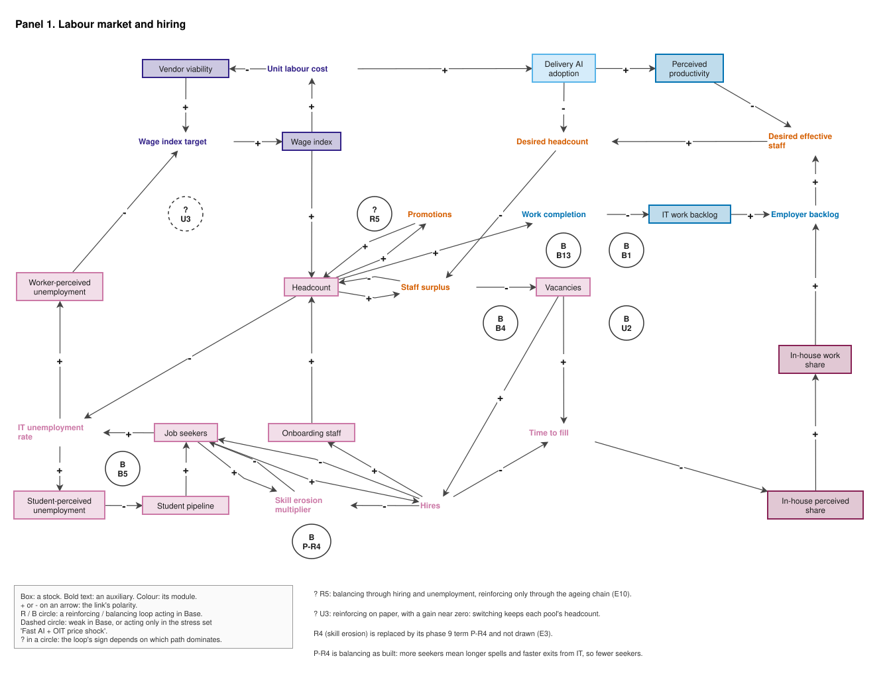

_Loops: B1, B13, B4, B5, P-R4, R4, R5, U2, U3. ? R5: balancing through hiring and unemployment, reinforcing only through the ageing chain (E10). ? U3: reinforcing on paper, with a gain near zero: switching keeps each pool's headcount. R4 (skill erosion) is replaced by its phase 9 term P-R4 and not drawn (E3). P-R4 is balancing as built: more seekers mean longer spells and faster exits from IT, so fewer seekers._

### Panel 2. Vendor distress

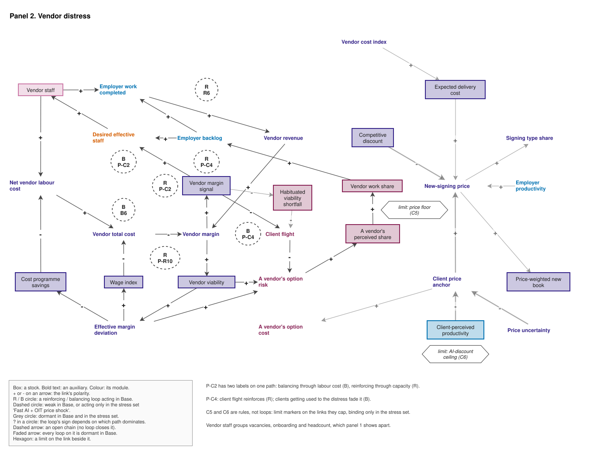

_Loops: B6, P-C2, P-C4, P-C5, P-C6, P-R10, R6. P-C2 has two labels on one path: balancing through labour cost (B), reinforcing through capacity (R). P-C4: client flight reinforces (R); clients getting used to the distress fade it (B). C5 and C6 are rules, not loops (limit markers). They bind only in the Fast AI scenario and the stress set: C5 (price floor) from 2028, C6 (AI-discount ceiling) from mid-2030. Vendor staff groups vacancies, onboarding and headcount, which panel 1 shows apart._

### Panel 3. Pricing and contracts

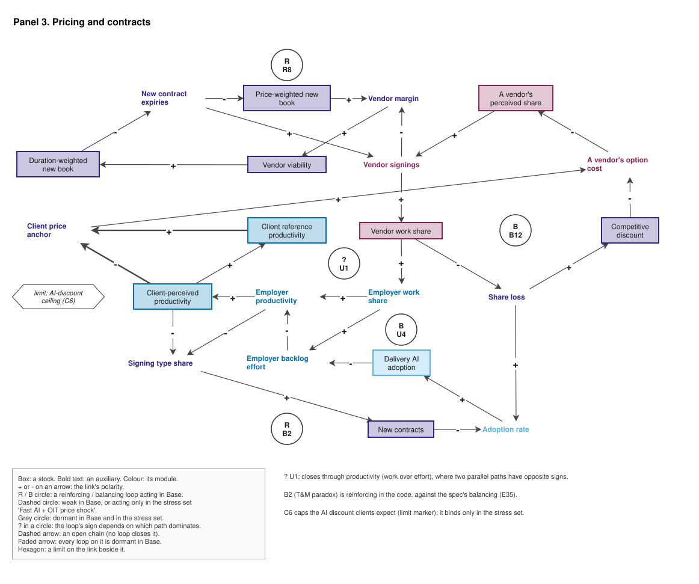

_Loops: B12, B2, R8, U1, U4. ? U1: closes through productivity (work over effort), where two parallel paths have opposite signs. B2 (T&M paradox) is reinforcing in the code, against the spec's balancing (E35). C6 caps the AI discount clients expect (limit marker). It binds only in the Fast AI scenario and the stress set, from mid-2030._

### Panel 4. Sourcing and GCC growth

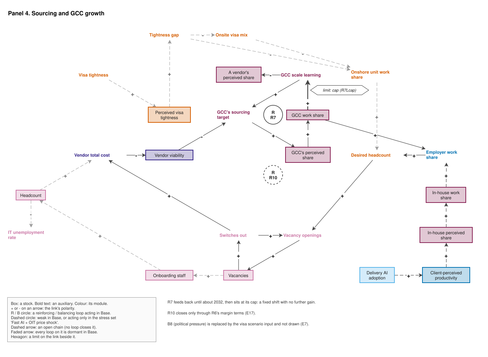

_Loops: B3, B7, B8, P-R7, R10, R7. R7 feeds back until about 2032, then sits at its cap: a fixed shift with no further gain. R10 closes only through R6's margin terms (E17). B8 (political pressure) is replaced by the visa scenario input and not drawn (E7)._

### Panel 5. Adoption, demand and capability

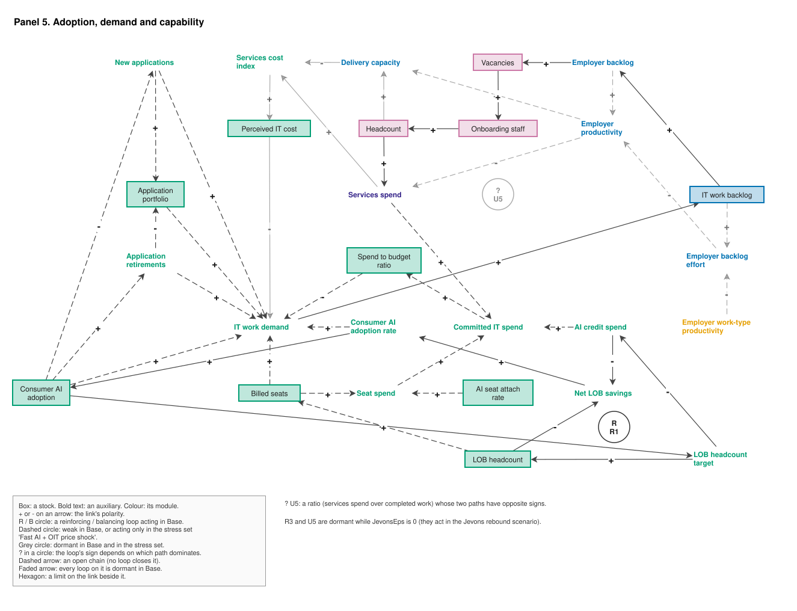

_Loops: B10, B11, B9, R1, R2, R3, U5. ? U5: a ratio (services spend over completed work) whose two paths have opposite signs. R3 and U5 are dormant while JevonsEps is 0 (they act in the Jevons rebound scenario)._

### The loops

34 loops (`docs/model/loop_summary.csv`).

| Loop | Name | Polarity | Status | Acts in Base | Acts in the stress set | Ruling |
| --- | --- | --- | --- | --- | --- | --- |
| R1 | Savings reinvestment | reinforcing | closed | yes | yes | E9 |
| R2 | AI begets IT work | none | open | chain only | chain only | E1 |
| R3 | Jevons effect | unclear | open | no (dormant) | no (dormant) | E2 |
| R4 | Skill erosion | balancing | replaced | replaced | replaced | E3, E18 |
| R5 | Shortage accelerates AI | mixed | closed | yes, partly | yes, partly | E10 |
| R6 | Vendor death spiral | reinforcing | closed | weak | yes | E11, E12, E13, E14, E20 |
| R7 | Captive learning | reinforcing | closed | yes, to 2032 | yes, to 2032 | E19, E24 |
| R8 | Repricing acceleration | reinforcing | closed | yes | yes | - |
| R10 | Talent poaching | reinforcing | partial | weak | yes | E17 |
| B1 | Productivity compression | balancing | closed | yes | yes | - |
| B2 | T&M paradox | reinforcing | closed | yes | yes | E35 |
| B3 | Insourcing | n/a | open | chain only | chain only | E4 |
| B4 | Talent pipeline gap | balancing | closed | yes | yes | - |
| B5 | Discouraged entry | balancing | closed | yes | yes | - |
| B6 | Right-sizing | balancing | closed | weak | yes | E12 |
| B7 | Local hiring substitution | n/a | open | no (inert) | no (inert) | E7 |
| B8 | Political pressure (optional) | n/a | replaced | replaced | replaced | E7 |
| B9 | Application displacement | n/a | open | chain only | chain only | E5 |
| B10 | Seat contraction | n/a | open | chain only | chain only | E9 |
| B11 | Budget crowding-out | n/a | open | chain only | chain only | E8 |
| B12 | Price competition | balancing | closed | yes | yes | - |
| B13 | Hiring delay | balancing | closed | yes | yes | - |
| P-R7 | GCC scale learning (phase 9 R7) | reinforcing | closed | yes, to 2032 | yes, to 2032 | E19 |
| P-C2 | Capacity exit (phase 9 R6 C2) | mixed | closed | no (dormant) | yes | E12, E13, E20 |
| P-C4 | Client flight (phase 9 R6 C4) | reinforcing | closed | no (dormant) | yes | E14, E13, E21 |
| P-R10 | Attrition cost (phase 9 R10) | reinforcing | closed | weak | yes | E17 |
| P-R4 | Skill erosion (phase 9 R4) | balancing | closed | yes (juniors) | yes (juniors) | E3, E18 |
| P-C5 | Price floor (phase 9 R6 C5, a rule) | n/a | rule (not a loop) | no (dormant) | yes | E15 |
| P-C6 | AI-discount ceiling (phase 9 R6 C6, a rule) | n/a | rule (not a loop) | no (dormant) | yes | E16 |
| U1 | Pricing anchor through sourcing | unclear | closed | yes | yes | - |
| U2 | Time-to-fill capacity | balancing | closed | yes | yes | - |
| U3 | Wage-driven switching | reinforcing | closed | near zero | near zero | - |
| U4 | Competitive push on vendor adoption | balancing | closed | yes | yes | - |
| U5 | Jevons through services spend | unclear | closed | no (dormant) | no (dormant) | E2 |

## Name clashes

Names shared by items of different kinds. Nothing is renamed; each entry is qualified by its kind, and each description states the clash.

| Name | Items |
| --- | --- |
| `Att` | `Att` (stock, consumer); `Att` (auxiliary, consumer); `Att` (output, consumer) |
| `Completion` | `Completion` (auxiliary, work); `Completion` (output, work) |
| `ConsIT` | `ConsIT` (auxiliary, consumer); `ConsIT` (output, consumer) |
| `Demand` | `Demand` (flow, consumer); `Demand` (output, consumer) |
| `G` | `G` (auxiliary, capability); `G` (output, capability) |
| `GCCScaleTerm` | `GCCScaleTerm` (auxiliary, sourcing); `GCCScaleTerm` (output, sourcing) |
| `LOB` | `LOB` (stock, consumer); `LOB` (output, consumer) |
| `P_all` | `P_all` (auxiliary, work); `P_all` (output, work) |
| `RevenueTot` | `RevenueTot` (auxiliary, finance); `RevenueTot` (output, finance) |
| `ServicesSpend` | `ServicesSpend` (auxiliary, finance); `ServicesSpend` (output, finance) |
| `VisaTight` | `VisaTight` (auxiliary, workforce); `VisaTight` (output, workforce) |
| `Wage` | `Wage` (auxiliary, finance); `Wage` (parameter, labour_market) |
